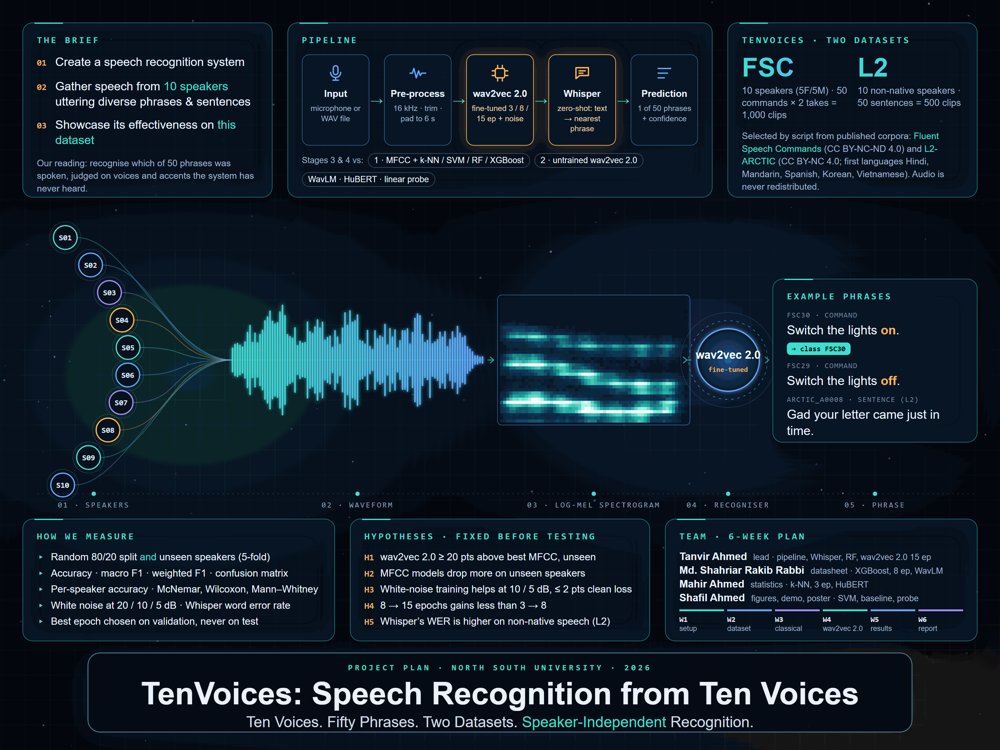

# 🎙️ TenVoices: Spoken Phrase Recognition on Two 10-Speaker Datasets

### Speech Recognition Systems · Course Project
**University Project | North South University (NSU)**


| Course | Section | Group | Instructor |
| :---: | :---: | :---: | :---: |
| *TBD* | *TBD* | *TBD* | *TBD* |

<p align="center">
  
</p>

<p align="center">
  <em>Project poster (planning edition). It still shows the earlier self-recorded dataset plan and is updated in task T39.</em>
</p>

## 📖 Overview
This project builds a **speech recognition system** that recognises which of **50 phrases or sentences** a person has spoken. We evaluate it on **TenVoices**: two **10-speaker** datasets that we select by script from published speech corpora, one of spoken commands and one of non-native English speakers. On both, we compare traditional machine learning, fine-tuned self-supervised speech models and a general-purpose speech-to-text model.

* **Traditional Machine Learning:** MFCC features with k-NN, SVM, Random Forest and XGBoost.
* **Deep Learning baseline:** wav2vec 2.0 with an untrained classification head (chance level).
* **Our approach:** wav2vec 2.0 **fine-tuned** for 3, 8 and 15 epochs with white-noise augmentation, plus WavLM Base+, HuBERT Base and a linear probe for comparison.
* **Open-vocabulary pipeline:** **Whisper** speech-to-text used **zero-shot**; its transcript is matched to the closest of the 50 phrases.

Every model is tested on a random 80/20 split (speakers seen in training) and with **speaker-independent 5-fold cross-validation** (speakers never heard), which is the headline result.

---

## 👥 Team: Who Does What
Each member owns one traditional model, one or two deep-learning runs, a part of the shared work and a set of files. **Each member's page** lists their files, their tasks with status, their faculty update and the exact task cards.

| Member | Responsible for | Models they run | Done so far | Next | Page |
| :--- | :--- | :--- | :--- | :--- | :---: |
| **Tanvir Ahmed** (lead) | Data preparation, shared code (pre-processing, splits, training, evaluation, Whisper, inference), merging everyone's work | Random Forest · wav2vec 2.0 15 epochs with / without noise · Whisper | Plan and repository; audio, config, metrics and Whisper code; TenVoices-FSC selected, checked and split; Random Forest and Whisper results on TenVoices-FSC; training, noise-test and inference code | wav2vec 2.0 15-epoch runs, TenVoices-L2, final results and report | [M1_tanvir](docs/team/M1_tanvir.md) |
| **Md. Shahriar Rakib Rabbi** | Datasheet, dataset statistics, listen-check, subset release | XGBoost · wav2vec 2.0 8 epochs + noise · WavLM Base+ | Phrase loader `support/phrases.py`; XGBoost (T12); Datasheet, statistics & listen-check (T09); Subset release (T26); wav2vec 2.0 8ep (T16); WavLM Base+ 15ep (T44) | All tasks completed | [M2_rabbi](docs/team/M2_rabbi.md) |
| **Mahir Ahmed** | Analysis plan, statistics, results table, hypothesis tests, error analysis | k-NN · wav2vec 2.0 3 epochs · HuBERT Base | Not started yet (takes over the metrics module `support/metrics.py`, written by Tanvir) | Analysis plan (T10), statistics (T33), k-NN (T13), literature (T37) | [M3_mahir](docs/team/M3_mahir.md) |
| **Shafil Ahmed** | Figures, demo app, poster, slides, demo video | SVM · untrained baseline · linear probe | Not started yet | SVM (T14), visualisation (T35), poster v2 (T39), untrained baseline (T18) | [M4_shafil](docs/team/M4_shafil.md) |

Task board with every task, its owner and status: [docs/STATUS.md](docs/STATUS.md).

---

## 📊 Datasets
We do not record our own audio (the instructor confirmed that published data meets the brief). **TenVoices** is two 10-speaker subsets (5 female, 5 male each) of published datasets, selected by a script with fixed rules, so anyone with the source data gets the same clips.

| | **TenVoices-FSC** (main) | **TenVoices-L2** (accents) |
| :--- | :--- | :--- |
| **Source** | [Fluent Speech Commands](https://fluent.ai/research/fluent-speech-commands/) (Lugosch et al., Interspeech 2019) | [L2-ARCTIC](https://psi.engr.tamu.edu/l2-arctic-corpus/) v5.0 (Zhao et al., Interspeech 2018) |
| **What is said** | Smart-home commands, e.g. "turn on the lights", "put on the music", "turn up the heat in the kitchen" | Read sentences from the CMU ARCTIC prompts |
| **Speakers** | 10 of the 97, chosen by script | 10 non-native speakers: a female and a male each with Hindi, Mandarin, Spanish, Korean and Vietnamese as first language |
| **Classes** | 50 commands; many share most of their words | 50 sentences read by all 10 speakers |
| **Clips** | 1,000 (2 takes per speaker and command); 997 pass every quality check | 500 (1 per speaker and sentence) |
| **Status** | ✅ selected, checked and split | ✅ selected, checked and split (from a free copy of the corpus, `data/SOURCES.md`) |
| **Licence** | CC BY-NC-ND 4.0, academic research only | CC BY-NC 4.0 |

The audio is not in this repository: we publish the subset lists, the selection script and checksums. Sources, download steps and selection rules: [docs/DATASETS.md](docs/DATASETS.md) · datasheet: [data/README.md](data/README.md)

---

## 🧠 Methodology

### 1. Traditional Machine Learning (Baseline)
* **Features:** Librosa, 13 MFCCs + Δ + ΔΔ, each summarised by mean and standard deviation (78 values), then standardised.
* **Models:** k-NN, SVM, Random Forest and XGBoost; hyper-parameters chosen on validation data only.

### 2. Deep Learning Baseline (Untrained)
* `facebook/wav2vec2-base` with a new classification head for the 50 classes, evaluated **without training** (chance is 2%).

### 3. Our Approach: Fine-Tuning Self-Supervised Speech Models
* **Model:** `facebook/wav2vec2-base` + classification head, fine-tuned on the raw audio.
* **Training:** AdamW, learning rate 3e-5, 10% warm-up, batch size 4 accumulated to 8; 3, 8 and 15 epochs compared.
* **Augmentation:** white noise added to half of the training clips; a 15-epoch run without noise isolates its effect.
* **Model selection:** the best epoch is chosen on validation data, never on the test set.
* **Comparisons:** the same script fine-tunes WavLM Base+ and HuBERT Base; a linear probe trains only a logistic regression on frozen wav2vec 2.0 features.
* **Input:** clips padded to 6 s, never cut. **Hardware:** Google Colab GPU (T4) or Apple Silicon (MPS).

### 4. Open-Vocabulary Pipeline: Whisper (Zero-Shot)
* **Model:** `openai/whisper-small`, English, **no training** on our data.
* **Phrase matching:** transcript and phrases are normalised the same way; the phrase with the smallest word-level edit distance is the prediction, so Whisper fits the same tables as every other model.
* **Extra output:** word and character error rate per clip, speaker and first language.

### Evaluation
Per dataset: random 80/20 split (stratified, seed 42) and 5 speaker-independent folds (2 test speakers, 1 validation, 7 training; every speaker tested once). Metrics: accuracy, macro and weighted F1, confusion matrices, per-speaker accuracy, WER / CER for Whisper. Statistics: bootstrap confidence intervals, McNemar, Wilcoxon and Mann–Whitney tests. Hypotheses H1–H5 and the frozen analysis decisions: [docs/PROJECT_PLAN.md](docs/PROJECT_PLAN.md).

---

## 🏆 Results
Measured so far on **TenVoices-FSC** (1,000 clips). Every number comes from the run's `summary.json` (`results/<run>/fsc/`; Tanvir's runs are in [`results/M1_tanvir/`](results/M1_tanvir/)); *TBD* means the run is not merged yet.

| Model | Owner | Accuracy, unseen speakers | Macro F1, unseen | Accuracy, random split | Macro F1, random | Purpose |
| :--- | :--- | :---: | :---: | :---: | :---: | :--- |
| **Baseline wav2vec 2.0 (untrained)** | Shafil | TBD | TBD | TBD | TBD | Chance level without training |
| **k-NN** | Mahir | TBD | TBD | TBD | TBD | Distance-based MFCC baseline |
| **SVM** | Shafil | TBD | TBD | TBD | TBD | Margin-based MFCC baseline |
| **Random Forest** | Tanvir | **20.9%** | 0.199 | **31.0%** | 0.299 | Tree ensemble on MFCC features |
| **XGBoost** | Rabbi | **16.9%** | 0.158 | **22.0%** | 0.208 | Gradient boosting on MFCC features |
| **wav2vec 2.0, 3 epochs** | Mahir | TBD | TBD | TBD | TBD | Short fine-tuning |
| **wav2vec 2.0, 8 epochs + noise** | Rabbi | **21.0%** | 0.198 | **40.5%** | 0.287 | Medium fine-tuning with augmentation |
| **wav2vec 2.0, 15 epochs + noise** | Tanvir | **88.5%** | 0.881 | **100.0%** | 1.000 | Full fine-tuning with augmentation |
| **wav2vec 2.0, 15 epochs, no noise** | Tanvir | **92.8%** | 0.927 | **85.5%** | 0.824 | Effect of noise augmentation (H3) |
| **WavLM Base+, 15 epochs + noise** | Rabbi | **33.6%** | 0.354 | **39.0%** | 0.332 | Another self-supervised model |
| **HuBERT Base, 15 epochs + noise** | Mahir | TBD | TBD | TBD | TBD | Another self-supervised model |
| **Linear probe (frozen wav2vec 2.0)** | Shafil | TBD | TBD | TBD | TBD | Pre-trained features without fine-tuning |
| **Whisper small, zero-shot + phrase matching** | Tanvir | **98.7%** | 0.987 | **99.0%** | 0.990 | General-purpose speech-to-text, no training |

* **Random Forest** drops from 31.0% to 20.9% when the test speakers were never heard in training: MFCC statistics depend heavily on the speaker.
* **Whisper** recognises the commands almost perfectly without any training; its word error rate on the unseen-speaker folds is 3.9%.
* **Fine-tuned wav2vec 2.0** (15 epochs + noise, trained on 7 speakers per fold) reaches 88.5% on unseen speakers (fold mean 88.5% ± 10.4), 67.6 points above Random Forest.
* **Noise robustness** (unseen speakers, white noise added to the test clips, `results/M1_tanvir/noise/`):

  | Model | Clean | 20 dB | 10 dB | 5 dB |
  | :--- | :---: | :---: | :---: | :---: |
  | wav2vec 2.0, 15 epochs + noise | 88.5% | 86.8% | 82.1% | 74.5% |
  | wav2vec 2.0, 15 epochs, no noise | 92.8% | 92.1% | 65.5% | 30.7% |
  | Random Forest | 20.9% | 4.9% | 2.3% | 2.2% |

  Training with white noise keeps the model usable in heavy noise (74.5% vs 30.7% at 5 dB) but costs 4.3 points on clean audio. H3 allows at most 2, so its strict criterion would fail; the official verdict comes from the hypothesis tests in T24. The MFCC model falls to chance level as soon as noise is added.
* **Speed** (`results/M1_tanvir/benchmark_fsc.csv`, one clip incl. pre-processing, MacBook): wav2vec 2.0 38.2 ms on the Apple GPU and 74.9 ms on the CPU (378 MB); Random Forest 13.7 ms (76 MB). Both are fast enough for live use.
* Confusion matrices: [results/M1_tanvir/figures/confusion/](results/M1_tanvir/figures/confusion/) (Tanvir's runs), `images/confusion/` (the other members' runs).
* **More figures** (Tanvir's runs, all drawn from the result files by `python -m support.figures --folder M1_tanvir`; gallery with explanations: [results/M1_tanvir/README.md](results/M1_tanvir/README.md)): seen vs unseen speakers, fine-tuning curves, noise robustness, accuracy per speaker, confidence, speed vs accuracy, Whisper's errors.

  

  

Measured so far on **TenVoices-L2** (500 clips, 10 non-native speakers; every fold tests a first language never heard in training). Numbers from `results/M1_tanvir/<run>/l2arctic/summary.json`.

| Model | Owner | Accuracy, unseen speakers | Macro F1, unseen | Accuracy, random split | Macro F1, random |
| :--- | :--- | :---: | :---: | :---: | :---: |
| **Random Forest** | Tanvir | **17.0%** | 0.149 | **9.0%** | 0.070 |
| **Whisper small, zero-shot + phrase matching** | Tanvir | **99.6%** | 0.996 | **100%** | 1.000 |

* **Random Forest** scores *lower* on seen speakers here: each speaker reads each sentence once, so the speaker's voice pulls the MFCC model towards that speaker's other sentences.
* **Whisper** still finds the right sentence, but makes more transcription errors on non-native speech: word error rate 10.0% on TenVoices-L2 vs 3.9% on TenVoices-FSC; per first language from 4.0% (Hindi) to 16.8% (Vietnamese) (`results/M1_tanvir/whisper_small/l2arctic/wer_per_l1.csv`). Hypothesis H5 is tested formally in T24.

---

## 📁 Repository Structure
```text
Voices-Speech-Recognition-445/
|-- README.md               this page: overview, team, results, how to run
|-- main.py                 inference: audio / video / microphone -> top-5 phrases
|-- requirements.txt
|-- AGENTS.md, CLAUDE.md    rules for members and AI assistants
|-- configs/config.yaml     every setting (paths, audio, models, training)
|-- support/                ALL code, one shared module per job (code map: support/README.md)
|-- tests/                  unit tests for every module
|-- notebooks/              Colab notebook for GPU training
|-- data/                   subset lists, phrase lists, splits, sources (audio is not in git)
|-- results/                one folder per model and dataset: metrics, predictions, reports
|   `-- M1_tanvir/          Tanvir's runs, noise tests, benchmark and figures in one place
|-- images/                 poster, confusion matrices, figures
|-- others/                 poster source, report, slides, demo video
`-- docs/
    |-- team/               ONE PAGE PER MEMBER: role, files, tasks, faculty update, task cards
    |-- STATUS.md           task board and merge log
    |-- PROJECT_PLAN.md     design, hypotheses, evaluation protocol, file ownership, risks
    |-- DATASETS.md         dataset sources, licences, selection rules
    |-- RUNS.md             how to run any model, locally or on Colab
    `-- CONTRIBUTING.md     the workflow as plain git commands
```

---

## 🛠️ Installation

1.  **Clone the repository:**
    ```bash
    git clone https://github.com/minhaz-42/Voices-Speech-Recognition-445.git
    cd Voices-Speech-Recognition-445
    ```

2.  **Create a virtual environment with Python 3.11 (Recommended):**
    ```bash
    python3.11 -m venv venv
    # Windows
    .\venv\Scripts\activate
    # Mac/Linux
    source venv/bin/activate
    ```

3.  **Install dependencies:**
    ```bash
    pip install -r requirements.txt
    ```

---

## 🚀 Usage
Run every command from the repository root; scripts in `support/` run as modules (`python -m support.<name>`). Getting the audio and running a model step by step: [docs/RUNS.md](docs/RUNS.md).

| Command | Purpose |
| :--- | :--- |
| `python -m unittest discover -s tests -v` | Run the unit tests |
| `python -m support.config` | Print the settings and resolved paths |
| `python -m support.audio clip.wav [--out clip_16k.wav]` | Pre-process one clip (mono, 16 kHz, trimmed, normalised, padded to 6 s) |
| `python -m support.whisper_asr clip.wav` | Transcribe a clip with Whisper (zero-shot) and show the 5 nearest phrases |
| `python -m support.select_subsets --dataset fsc` | Select a 10-speaker subset from the downloaded dataset |
| `python -m support.qc_report --dataset fsc` | Quality report of a subset |
| `python -m support.dataset --dataset fsc --build` | Processed 16 kHz copies + manifest (checks every clip's SHA-256) |
| `python -m support.make_splits --dataset fsc` | Random 80/20 split + 5 speaker-independent folds, leakage-checked |
| `python -m support.classical --dataset fsc --model svm --split all` | Train and evaluate a traditional model (`random_forest`, `xgboost`, `knn`, `svm`) |
| `python -m support.train_wav2vec2 --dataset fsc --epochs 15 --noise white` | Fine-tune wav2vec 2.0 on every split (`--untrained` for the baseline, `--model` for WavLM / HuBERT); Colab: `notebooks/train_wav2vec2.ipynb` |
| `python -m support.whisper_asr --dataset fsc --split all` | Zero-shot Whisper on the same test clips, with WER per speaker and first language |
| `python -m support.evaluate --dataset fsc --run random_forest` | Rebuild a run's metrics, reports and confusion matrices |
| `python -m support.noise_test --run w2v2_15ep_noise --dataset fsc` | Accuracy with white noise at 20 / 10 / 5 dB |
| `python main.py --audio clip.wav --model <saved model>` | Top-5 phrases for an audio file (also `--video`, `--mic`, `--asr whisper`, `--benchmark N`) |
| `python app.py` | Live microphone demo (Gradio), task T36 |

---

## 🔮 Future Work
* **Fine-tuned speech-to-text:** fine-tune Whisper (or wav2vec 2.0 with CTC) on non-native speech to reduce its word errors, and move from 50 known phrases to free speech-to-text.
* **Stronger models:** compare with XLS-R, which is pre-trained on many more languages.
* **Bangladeshi speakers:** test the trained models on Bangladeshi speakers reading the same commands.
* **More speakers:** use the full Fluent Speech Commands corpus (97 speakers) and measure how results scale with the number of training speakers.

---

## 🔒 Ethics & Licences
* **No new recordings:** we record no one and store no personal data. Both datasets were collected and released by their authors; speakers appear only under the datasets' own anonymous IDs.
* **Licences respected:** Fluent Speech Commands (CC BY-NC-ND 4.0, academic research only) and L2-ARCTIC (CC BY-NC 4.0) are used non-commercially and cited. Their audio stays in a private team folder and is never committed or re-published.

---

## 🔄 Team Workflow
Every member works on their own branch (`dev_rabbi`, `dev_mahir`, `dev_shafil`), by hand or with any AI assistant, pushes at the end of every session and opens a pull request; Tanvir reviews and merges into `main`. Steps: [docs/CONTRIBUTING.md](docs/CONTRIBUTING.md) · rules for assistants: [AGENTS.md](AGENTS.md).

---

## 📄 License
* **Code, subset lists and selection script:** [MIT](LICENSE).
* **Audio:** not distributed here. Fluent Speech Commands: CC BY-NC-ND 4.0 ([Lugosch et al., 2019](https://arxiv.org/abs/1904.03670)); L2-ARCTIC: CC BY-NC 4.0 ([Zhao et al., 2018](https://doi.org/10.21437/Interspeech.2018-1110)).
