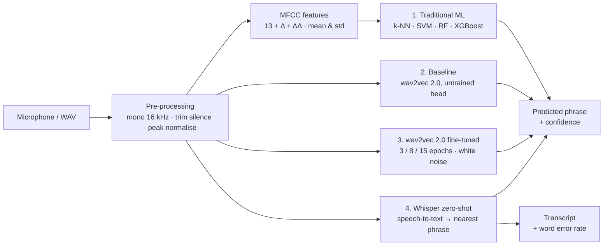

# 🎙️ TenVoices: Project Plan

> **Plan version 3.0 · 17 Oct 2026 · status: planning.** Tasks, owners and progress are in [STATUS.md](STATUS.md); dataset sources, licences and selection rules are in [DATASETS.md](DATASETS.md).
> **Change in version 3.0:** we no longer record our own audio. TenVoices is now two 10-speaker subsets of two published speech datasets (see **📊 Datasets**).

---

## 📌 At a Glance

| | |
|---|---|
| **Brief** | *Create a speech recognition system. Gather a dataset consisting of speech samples from 10 speakers uttering diverse phrases or sentences. Showcase the effectiveness of your method using this dataset.* |
| **Task** | **Spoken phrase recognition:** given a recording, recognise which of **50 phrases or sentences** was spoken |
| **Datasets** | **TenVoices**: two 10-speaker subsets that we select, check and document from published datasets. **TenVoices-FSC** (main): 10 speakers × 50 spoken commands × 2 takes from *Fluent Speech Commands* (up to 1,000 clips). **TenVoices-L2** (accents): 10 non-native speakers × 50 read sentences from *L2-ARCTIC* (500 clips). |
| **Methods** | Traditional ML (MFCC + k-NN / SVM / Random Forest / XGBoost) vs an untrained wav2vec 2.0 baseline vs **fine-tuned wav2vec 2.0** (3 / 8 / 15 epochs, white-noise augmentation), plus **Whisper** used zero-shot as an open-vocabulary recogniser (speech-to-text, then the nearest phrase) |
| **Evaluation** | Accuracy, macro F1, weighted F1, confusion matrices; word error rate for Whisper. Every model on both datasets, on a random 80/20 split (seen speakers) **and** with speaker-independent 5-fold cross-validation (unseen speakers, the headline). |
| **Team** | Four members: Tanvir Ahmed (lead), Md. Shahriar Rakib Rabbi, Mahir Ahmed and Shafil Ahmed. Each owns one traditional model, one deep-learning run, a workstream and a set of files, and works on their own branch; the lead reviews and merges. |
| **Timeline** | 6 weeks, planned week by week |
| **Deliverables** | Open GitHub repo, subset lists + selection script + datasheet, inference script + demo app, results tables and confusion matrices, report, slides, demo video, poster |

---

## 📖 The Brief and Our Interpretation

| Requirement in the brief | What we deliver | How it can be checked |
|---|---|---|
| "Create a speech recognition system" | A recogniser that tells which of 50 phrases was spoken, with an inference script (`main.py`) and a live demo (`app.py`) for the 50 spoken commands | Run the demo and say a command |
| "Gather a dataset … from 10 speakers uttering diverse phrases or sentences" | We **gather** each dataset by selecting 10 speakers (5 female, 5 male) and 50 phrases or sentences from a published corpus with a fixed, scripted rule, then check every clip and write a datasheet | `data/subsets/`, `support/select_subsets.py`, `data/README.md` |
| "Showcase the effectiveness of your method using this dataset" | A comparison of traditional ML, an untrained baseline, fine-tuned wav2vec 2.0 and zero-shot Whisper, on seen and unseen speakers, in clean and noisy audio, on both datasets | `results/all_results.csv`, confusion matrices, statistics |

**Interpretation**
- Speech recognition is framed as **closed-set phrase recognition**, the same way spoken commands are recognised by voice assistants. Every phrase is a class.
- **Why two datasets.** TenVoices-FSC holds short spoken commands such as "turn on the lights", "lights on" and "turn up the heat in the kitchen". Many commands share most of their words, and different wordings of the same request are different classes, so recognising them requires the actual words, not just the voice. TenVoices-L2 holds longer read sentences from non-native speakers with different first languages, including Hindi, the accent in that corpus closest to Bangladeshi English. A method that only works on one of them is not convincing.
- The system can also **transcribe** free speech. Whisper turns a recording into text without any training on our data, and the closest of the 50 phrases becomes its prediction. Its word error rate shows how a general-purpose recogniser copes with non-native accents.
- **Effectiveness** must hold for **speakers the system has never heard**. Every model is also scored on a random split, so the gap between seen and unseen speakers is visible.
- **Confirmed by the instructor (17 Oct 2026):** the brief needs the data, not our own recordings, so published datasets are acceptable.

---

## 🎯 Objectives, Research Questions and Hypotheses

**Objectives**
- **O1** Build the two TenVoices subsets (10 speakers each) with a reproducible selection script, quality control, metadata and a datasheet.
- **O2** Build a working phrase recogniser with an inference script and a live demo.
- **O3** Compare traditional ML, fine-tuned wav2vec 2.0 and zero-shot Whisper on seen and unseen speakers, in clean and noisy audio, on both datasets.
- **O4** Release code, subset lists and results openly and reproducibly (the audio stays with its original publishers).

**Research questions**
- **RQ1** How accurately do MFCC-based traditional models recognise the 50 phrases?
- **RQ2** How much does fine-tuning wav2vec 2.0 improve on them, and how do 3, 8 and 15 epochs compare?
- **RQ3** How much accuracy is lost on unseen speakers compared with a random split?
- **RQ4** Does white-noise augmentation make the model more robust to noisy audio?
- **RQ5** How does a general-purpose speech-to-text model (Whisper, zero-shot) compare with models trained on each dataset, and how much do non-native accents hurt it?
- **RQ6** Do the answers to RQ1–RQ5 hold on both datasets?

**Hypotheses.** Frozen on 2026-10-17, before any model was trained (exact decisions: *Frozen analysis decisions* in the Evaluation Protocol). They are reported whether or not they hold. H1–H4 are tested on each dataset separately; `docs/ANALYSIS_PLAN.md` (T10) documents the analysis in full and cannot change these decisions.

| ID | Hypothesis | Pass criterion |
|---|---|---|
| H1 | Fine-tuned wav2vec 2.0 beats the best traditional model on unseen speakers | ≥ 20 points higher accuracy; McNemar test p < 0.05 |
| H2 | Traditional models depend more on knowing the speaker | The accuracy drop from random split to unseen speakers is larger for the best MFCC model than for wav2vec 2.0 |
| H3 | White-noise augmentation improves robustness | Higher accuracy at 10 dB and 5 dB SNR than the same run without noise, with ≤ 2 points loss on clean audio |
| H4 | Longer fine-tuning has diminishing returns | The gain from 8 → 15 epochs is smaller than from 3 → 8 epochs |
| H5 | A general-purpose speech-to-text model struggles more with non-native speech | Whisper's per-speaker word error rate is higher on TenVoices-L2 than on TenVoices-FSC (one-sided Mann–Whitney U test over the 10 + 10 speakers, p < 0.05) |

H5 compares different texts (long sentences vs short commands) as well as different speakers. The analysis also reports Whisper's WER per first language within TenVoices-L2, where the texts are identical, and the discussion names the text difference as a limitation.

---

## 📦 Scope (MoSCoW)

- **Must:**
  - Datasets: TenVoices-FSC (10 speakers × 50 phrases × 2 takes) and TenVoices-L2 (10 speakers × 50 sentences), selected by script, with QC, metadata and a datasheet
  - Pre-processing and MFCC features
  - k-NN, SVM, Random Forest and XGBoost
  - Untrained wav2vec 2.0 baseline
  - wav2vec 2.0 fine-tuned for 3, 8 and 15 epochs
  - Random 80/20 split and speaker-independent 5-fold CV, on both datasets
  - Accuracy / macro F1 / weighted F1 with confusion matrices
  - `results/all_results.csv`
  - `main.py` inference, README, report, slides, demo video, poster
- **Should:** two other self-supervised models fine-tuned with the same script (WavLM Base+, HuBERT Base) and a linear probe on frozen wav2vec 2.0 features (exploratory comparisons), Whisper zero-shot speech-to-text with phrase matching and word error rate per speaker and first language, white-noise SNR tests, a 15-epoch run without noise (to isolate the effect of noise), per-speaker and per-accent analysis, significance tests, Gradio demo, GitHub Actions unit tests.
- **Could:** the full Fluent Speech Commands corpus (97 speakers) with its official speaker-independent splits, XLS-R 300M, fine-tuning Whisper, a Hugging Face Space demo.
- **Won't (this semester):** recording our own speakers, open-vocabulary transcription as the main task, training a model from scratch.

---

## 📊 Datasets

Sources, licences, download steps, folder layout and the exact selection and QC rules: [DATASETS.md](DATASETS.md).

| | **TenVoices-FSC** (main) | **TenVoices-L2** (accents) |
|---|---|---|
| Source | *Fluent Speech Commands* (Lugosch et al., Interspeech 2019) | *L2-ARCTIC* v5 (Zhao et al., Interspeech 2018) |
| Source size | 30,043 clips, 97 speakers, 248 phrasings of 31 intents, 19 hours, 16 kHz mono | 24 non-native speakers (6 first languages × 2 F + 2 M), about 1 hour each, 44.1 kHz |
| What speakers say | Smart-home commands ("put on the music", "turn up the heat in the kitchen"); each speaker was recorded saying each phrasing twice | The same CMU ARCTIC prompt sentences, read once by every speaker |
| Our 10 speakers | 5 female, 5 male, chosen by script from the dataset's demographics file | Hindi: TNI (F), ASI (M) · Mandarin: LXC (F), BWC (M) · Spanish: NJS (F), EBVS (M) · Korean: HJK (F), YKWK (M) · Vietnamese: PNV (F), HQTV (M) |
| Our 50 classes | The 50 phrasings recorded twice by the most speakers | 50 sentences read by all 10 speakers, drawn with seed 42 |
| Takes per speaker and class | 2 | 1 |
| Clips | up to **1,000** (the datasheet reports the exact number) | **500** |
| Licence | CC BY-NC-ND 4.0, academic research only | CC BY-NC 4.0 |

- **Selection is code, not hand-picking:** `support/select_subsets.py` (task T42) applies the rules in DATASETS.md with seed 42 and writes the subset lists to `data/subsets/`, so anyone with the source data gets the same clips.
- **Every clip is checked** (task T43): readable, 0.5–6 s after trimming, no clipping. A clip that fails is replaced by the next eligible one under the same rule.
- **Accents.** L2-ARCTIC has no Bangla-L1 speakers; Hindi is its closest accent to Bangladeshi English. TenVoices-L2 uses a free copy of the corpus (15 of its 24 speakers, `data/SOURCES.md`), so it has one female and one male for each of five first languages: Hindi, Mandarin, Spanish, Korean and Vietnamese.

---

## 🧠 Methodology

Every model is trained and tested separately on each dataset (`--dataset fsc` or `--dataset l2arctic`), with the same settings.

### 1. Traditional Machine Learning (Baseline)
- **Features:** Librosa MFCCs (13) + Δ + ΔΔ, each summarised by mean and standard deviation (78 values per clip), then standardised (`StandardScaler`).
- **Models:** k-NN, SVM (RBF kernel), Random Forest and XGBoost. Each model's hyper-parameters are tuned on validation data only.
- **Outputs:** per model and dataset, a classification report CSV, the predictions and a confusion matrix.

### 2. Deep Learning Baseline (Untrained)
- `facebook/wav2vec2-base` with a new, untrained classification head for the 50 classes, evaluated without any training.
- It shows the chance level (2% for 50 classes) and proves that later gains come from fine-tuning.

### 3. Our Approach: Fine-Tuned wav2vec 2.0

| Setting | Plan |
|---|---|
| Model | `facebook/wav2vec2-base` + audio-classification head (`AutoModelForAudioClassification`), 50 classes |
| Input | 16 kHz audio, padded to 6 s. No phrase is cut: clips longer than 6 s after trimming are excluded at selection. |
| Training | AdamW, learning rate 3e-5, batch size 4 with gradient accumulation 2, 10% warm-up |
| Runs | 3 epochs (no noise), 8 epochs + white noise, 15 epochs + white noise, and 15 epochs without noise (ablation), on each dataset |
| Augmentation | White noise added to 50% of training clips (random amplitude), training data only |
| Model selection | Best epoch chosen on **validation data**, never on the test set |
| Hardware | Google Colab GPU (T4) or Apple Silicon (MPS); one shared script for every run |

### Exploratory: Other Self-Supervised Models and a Linear Probe

Each runs with the shared code and the same splits, so it is one more row in every table. They are compared with fine-tuned wav2vec 2.0 descriptively (McNemar p-values marked *exploratory*); no hypothesis depends on them.

| Model | How | Question |
|---|---|---|
| WavLM Base+ (`microsoft/wavlm-base-plus`) | `support/train_wav2vec2.py --model … --epochs 15 --noise white` | Does a newer pre-training objective help? |
| HuBERT Base (`facebook/hubert-base-ls960`) | same script and settings | Does a different pre-training target help? |
| Linear probe | frozen wav2vec 2.0 features, mean-pooled, + logistic regression (`support/classical.py --features w2v2`) | How much of the gain comes from the pre-trained features alone, without fine-tuning? |

### 4. Open-Vocabulary Pipeline: Whisper (Zero-Shot)

| Setting | Plan |
|---|---|
| Model | `openai/whisper-small`, English transcription, **no training on our data** |
| Text normalisation | Whisper's English text normaliser is applied to the transcript and to the 50 phrase texts (case, punctuation, numbers as words or digits) |
| Phrase matching | The prediction is the phrase with the smallest word-level edit distance to the transcript, so it fits the same tables, metrics and statistical tests as the other models |
| Extra output | The transcript itself, with word and character error rate (WER, CER) per clip, per speaker, per dataset and, on TenVoices-L2, per first language |
| Demo | `main.py` and `app.py` show the transcript; a transcript far from every phrase is reported as "not one of the 50 phrases" |
| Hardware | Laptop CPU / MPS for development, Colab GPU for the full set |

### Shared Components
- **One evaluation script for every model:** it writes a classification report, the predictions, a confusion matrix and a row of `results/all_results.csv` (one row per model and dataset).
- **Inference (`main.py`):** loads the best model, reads a WAV/MP3 (or the audio of an MP4) or a microphone recording, and prints the top-5 phrases with confidence. With `--asr whisper` it also prints the Whisper transcript.
- **Demo (`app.py`):** a Gradio page for the 50 TenVoices-FSC commands, with microphone input, the predicted command and a confidence bar chart.

---

## 🧪 Experiments

Every experiment runs on both datasets unless the setup says otherwise.

| ID | Question | Setup | Metrics | Owner | Week | Priority |
|---|---|---|---|---|---|---|
| E0 | What did we select? | Statistics per speaker / phrase / first language | Counts, durations, SNR estimate | M2 | 2 | Must |
| E1 | How good is traditional ML? | k-NN (M3), SVM (M4), Random Forest (M1), XGBoost (M2) on both splits | Accuracy, macro F1, weighted F1, confusion matrix | M1–M4 | 3 | Must |
| E2 | What is chance level? | Untrained wav2vec 2.0 | Same | M4 | 4 | Must |
| E3 | How much does fine-tuning help? | wav2vec 2.0: 3 epochs (M3), 8 epochs + noise (M2), 15 epochs + noise (M1), on both splits | Same + learning curves | M1–M3 | 4 | Must |
| E4 | Seen vs unseen speakers | Random split vs speaker-independent CV for every model; per-speaker accuracy | Accuracy drop, per-speaker table | M3 | 5 | Must |
| E5 | Noise robustness | White noise at 20 / 10 / 5 dB on the test clips; 15 epochs with vs without noise | Accuracy vs SNR | M1 | 5 | Should |
| E6 | Where are the errors? | Most-confused phrase pairs (e.g. two wordings of one request, or commands that differ in one word), accuracy per phrase and per intent | Confusion analysis | M3 | 5 | Must |
| E7 | Is it practical? | Inference time per clip on laptop CPU vs GPU; model size | ms per clip, MB | M1 | 5 | Should |
| E8 | How good is general-purpose speech-to-text without training? | Whisper small, zero-shot, + phrase matching on the test clips of both splits | Accuracy, F1, WER, CER per speaker and dataset | M1 | 4 | Should |
| E9 | Do accents matter? | TenVoices-L2 only: accuracy and Whisper WER per first language; every fold holds out a whole first language | Per-L1 accuracy and WER | M3 | 5 | Should |
| E10 | Do other self-supervised models or frozen features do as well? | WavLM Base+ (M2), HuBERT Base (M3), 15 epochs + noise; linear probe on frozen wav2vec 2.0 (M4); compared with wav2vec 2.0 15 epochs + noise | Same; McNemar (exploratory) | M2–M4 | 4 | Should |

---

## 📏 Evaluation Protocol (frozen in task T10)

Applied to each dataset separately.

- **Random split (seen speakers).** Stratified 80/20 split of the clips by phrase (seed 42); 10% of the training part is held out for validation. The same speakers appear in training and testing.
- **Speaker-independent CV (unseen speakers, the headline).**
  - 5 folds, each with 2 test speakers (one female and one male), 1 validation speaker and 7 training speakers.
  - Every speaker is a test speaker exactly once. Splits are saved in `data/splits/<dataset>/`.
  - On TenVoices-L2 the two test speakers of a fold share a first language, so each fold tests an accent the model has never heard in training: fold 1 Hindi, 2 Mandarin, 3 Spanish, 4 Korean, 5 Vietnamese. (Changed on 2026-10-17, before any L2 model was trained: the free copy of the corpus lacks some of the speakers first planned.)
- **Noisy tests.** White noise added to the clean test clips at 20 / 10 / 5 dB SNR.
- **Whisper (zero-shot)** uses no training data. It is scored on exactly the same test clips as the other models, so its results sit in the same tables.
- **Metrics:**
  - Accuracy (primary), macro F1, weighted F1.
  - Word and character error rate (WER, CER) for the Whisper transcripts.
  - Per-class F1 and confusion matrices.
  - Per-speaker accuracy; per first language on TenVoices-L2.
- **Statistics:**
  - 95% bootstrap confidence intervals for accuracy.
  - McNemar's test for paired model comparisons on the same clips.
  - Wilcoxon signed-rank test over the 10 per-speaker accuracies.
  - Mann–Whitney U test for comparing the two datasets' speakers (H5).
- **Leakage guards (unit-tested):**
  - No speaker appears in more than one of {train, validation, test} within a fold.
  - Noise-augmented copies are made from training clips only.
  - Model selection never sees the test set.

**Frozen analysis decisions (2026-10-17, M1, before any model was trained).** These fix every choice a hypothesis test depends on, so runs never wait for the analysis plan (T10), which documents them in full:

| Decision | Frozen as |
|---|---|
| Headline numbers for the folds | Predictions of all 5 folds pooled (every clip tested once); mean ± standard deviation over folds reported alongside |
| "Fine-tuned wav2vec 2.0" in H1, H2 | `w2v2_15ep_noise` |
| "Best traditional model" in H1, H2 | The MFCC model with the highest pooled-fold accuracy on that dataset |
| H1 test | Exact two-sided McNemar on the pooled-fold predictions, α = 0.05, plus the ≥ 20-point accuracy difference |
| H2 measure | Accuracy drop = random-split accuracy − pooled-fold accuracy; compared directly (with 95% bootstrap intervals reported) |
| H3 comparison | `w2v2_15ep_noise` vs `w2v2_15ep` on the pooled-fold test clips at 10 dB and 5 dB (identical noise per clip, `support/noise_test.py`) and clean |
| H4 runs | `w2v2_3ep`, `w2v2_8ep_noise`, `w2v2_15ep_noise`, pooled-fold accuracy (the 3-epoch run has no noise; named as a limitation) |
| H5 test | One-sided Mann–Whitney U, alternative: per-speaker WER on TenVoices-L2 > TenVoices-FSC, exact, α = 0.05; per-speaker WER = corpus WER over that speaker's clips |
| Multiple comparisons | One primary test per hypothesis and dataset at α = 0.05, no correction; all other p-values (per-speaker Wilcoxon, exploratory model comparisons) are labelled exploratory |
| Bootstrap | 10,000 resamples of clips, percentile 95% interval, seed 42 |

---

## ✅ Quality Rules

- **Fixed data:** every result is measured on the two TenVoices subsets, selected by script before any model is trained. The subsets do not change after the splits are made (tag `data-v1`).
- **No cut speech:** clips are padded to 6 s and never truncated mid-phrase.
- **Honest model selection:** the best epoch and all hyper-parameters are chosen on validation data, never on the test set.
- **Unseen speakers count:** a random split is reported, but the headline is speaker-independent.
- **Balanced design:** every selected speaker has the same number of takes of every selected phrase, so no class or speaker dominates.
- **One shared module per function:** no personal copies of scripts. Settings live in `configs/`; paths are relative; runs are chosen with CLI arguments (e.g. `--dataset fsc --epochs 15 --noise white`).
- **One source of truth for numbers:** every number in the README, report, slides and poster comes from `results/`. README commands are tested on a clean clone before submission.
- **Repository hygiene:** no audio, model weights or large media in git. The datasets' audio is never committed or re-published.
- **Decide before measuring:** the analysis plan and hypotheses are frozen before the main experiments.

---

## 👥 Team, Roles and File Ownership

Each member owns one traditional model, one or two deep-learning runs, a main workstream and a set of files. The lead keeps the shared, most complex parts (data preparation, training and evaluation code, the Whisper pipeline, noise tests, inference) and merges everyone's work.

**Nobody waits for anyone.** Every member task depends only on work that is already merged (the shared code and the TenVoices-FSC subsets and splits, merged on 2026-10-17) or on the member's own earlier tasks. Work that needs everyone's results (the combined results table, the hypothesis tests, the final figures) is split in two: the member writes and tests the code on synthetic or partial results, and the lead runs it once on all merged results at the end (T24). TenVoices-L2 is prepared and run by the lead (T47), so no member waits for it either.

| Slot | Member | Traditional model | Deep-learning run | Main workstream |
|---|---|---|---|---|
| **M1** (lead) | Tanvir Ahmed | Random Forest | wav2vec 2.0 15 epochs with and without noise, Whisper zero-shot | Data preparation (both datasets), shared training and evaluation code, Whisper pipeline, noise tests, inference, TenVoices-L2 runs, final aggregation and merging |
| **M2** | Md. Shahriar Rakib Rabbi | XGBoost | wav2vec 2.0 8 epochs + noise; **WavLM Base+** 15 epochs + noise | Datasheet, listen-check, dataset statistics, subset release |
| **M3** | Mahir Ahmed | k-NN | wav2vec 2.0 3 epochs; **HuBERT Base** 15 epochs + noise | Evaluation code: analysis plan, statistics, results table, hypothesis tests, error analysis |
| **M4** | Shafil Ahmed | SVM | Untrained baseline; **linear probe** on frozen wav2vec 2.0 | Visualisation, demo app, poster, slides, video |

**File ownership.** A member edits only their own files, so branches never conflict when they are merged. Changes needed in someone else's file go to that owner (for M1: under *Requests for the lead* on the member's page).

| Slot | Owns |
|---|---|
| **M1** | `main.py`, `support/config.py`, `support/audio.py`, `support/dataset.py`, `support/features.py`, `support/classical.py`, `support/evaluate.py`, `support/train_wav2vec2.py`, `support/noise.py`, `support/noise_test.py`, `support/device.py`, `support/inference.py`, `support/whisper_asr.py`, `support/select_subsets.py`, `support/qc_report.py`, `support/make_splits.py`, `data/subsets/`, `data/prompts/`, `data/splits/`, `data/SOURCES.md`, `configs/`, `notebooks/`, `requirements.txt`, `.github/`, `AGENTS.md`, `CLAUDE.md`, `CONTRIBUTING.md`, `README.md`, `docs/STATUS.md`, `docs/PROJECT_PLAN.md`, `docs/team/`; runs `random_forest`, `w2v2_15ep_noise`, `w2v2_15ep`, `whisper_small` and the noise tests, all in `results/M1_tanvir/` |
| **M2** | `support/phrases.py`, `data/README.md` (datasheet), `data/metadata/`, `data/listen_check_<dataset>.csv`, `docs/DATASETS.md`; runs `xgboost`, `w2v2_8ep_noise`, `wavlm_15ep_noise` |
| **M3** | `support/metrics.py`, `support/stats.py`, `support/results_table.py`, `support/error_analysis.py`, `support/hypotheses.py`, `docs/ANALYSIS_PLAN.md`, `docs/literature/classical_and_evaluation.md`; runs `knn`, `w2v2_3ep`, `hubert_15ep_noise`; `results/all_results.csv`, `results/hypotheses.csv`, `results/errors/` |
| **M4** | `support/visualization.py`, `app.py`, `others/poster.html`, `images/poster.png`, slides and video in `others/`, `docs/literature/self_supervised_speech.md`, `support/embeddings.py`; runs `svm`, `w2v2_untrained`, `w2v2_probe` |
| **Everyone** | Their own tests (`tests/test_<module>.py`), their run folders `results/<run>/`, their figures in `images/`, and the status, faculty update, requests and handoff sections of their page `docs/team/<slot>_<name>.md` |

Every model run goes through the shared scripts with its own settings, and saves its results in `results/<run-name>/<dataset>/`; M1's runs, noise tests, benchmark and figures are kept together in `results/M1_tanvir/` (`result_folders` in the config).

---

## 🔀 Team Workflow (branch per member)

Every member works on their own branch, so nobody waits for anyone else. Members can work by hand or with any AI assistant (Claude Code, Codex, Cursor, Copilot, ChatGPT, Gemini, …):

- **`AGENTS.md`** holds the project summary, the team, the session rules and the merge routine. Many coding assistants read it automatically; `CLAUDE.md` imports it for Claude Code.
- **`docs/CONTRIBUTING.md`** gives the same steps as plain commands, with a ready-made prompt for chat assistants. **`docs/RUNS.md`** shows how to run any model.
- **`docs/team/<slot>_<name>.md`** is each member's page: role, files, models, task status, faculty update, handoff log, and at the end the card for each of their tasks (files to create, functions to use, tests, *done when*).
- **`docs/STATUS.md`** is the task board (owner, dependencies, status) and merge log. Only the lead edits it.

| Member | Branch |
|---|---|
| M1 Tanvir (lead) | `main` |
| M2 Rabbi | `dev_rabbi` |
| M3 Mahir | `dev_mahir` |
| M4 Shafil | `dev_shafil` |

A typical week:
1. A **member** switches to their branch, merges in the latest `main` and checks what is done and what is next (an assistant does this when told who the member is).
2. They take their next task whose dependencies are ✅ (merged, or finished earlier by the same member) and follow its task card.
3. They run the tests, update their page and faculty update, commit, push the branch and open a pull request.
4. The **lead** reviews the branch, merges it into `main` and marks the tasks ✅ on the board. Everyone else picks the work up at the start of their next session.

Rules:
- **Branching:** members never commit to `main` and never rebase or force-push their branch; the lead merges.
- **Commits:** one task per commit, message `T07: 
`, with the member's own git identity and no AI tool named as author or co-author.
- **Data:** the source datasets are shared through the private team Drive (`TenVoices/raw/`), never through git. Small result files go in `results/` and are committed so others can continue. Trained models go to Drive or Hugging Face, never git.
- **Definition of done:**
  - The task's *done when* condition is met and the tests pass.
  - Code is config-driven, uses relative paths and has docstrings.
  - No audio, models or personal data committed.
  - The member's page is updated, including the faculty update.

---

## 🗓️ Development Roadmap

- Week 1: Planning, repository setup, shared code, dataset access.
- Week 2: Subset selection and QC for both datasets, datasheet and data splits.
- Week 3: MFCC features and traditional ML models (k-NN, SVM, Random Forest, XGBoost) on both datasets.
- Week 4: wav2vec 2.0: untrained baseline and fine-tuning for 3, 8 and 15 epochs with white noise; Whisper zero-shot speech-to-text.
- Week 5: Combined results, seen vs unseen speakers, accents, noise tests, error analysis, inference script and demo.
- Week 6: Report, slides, demo video, poster and final polish.

The tasks for each week, with owners and dependencies, are in [STATUS.md](STATUS.md). If the instructor's deadlines differ, stretch or compress the weeks; the order of the work stays the same.

---

## 📝 Deliverables and Reporting

- **Results:**
  - `results/all_results.csv` with one row per model and dataset: accuracy, macro F1, weighted F1, for both splits.
  - `images/all_results_table.png`.
  - A confusion matrix per model and dataset in `images/`.
- **Final report:** paper format, two columns, ~8 pages (the instructor's template if one is given):

| Section | Owner |
|---|---|
| Abstract, 1. Introduction | M1 |
| 2. Related work (speech recognition with MFCC and classical ML, self-supervised speech models, general-purpose speech-to-text) | M1, from M3's and M4's literature notes |
| 3. The TenVoices subsets (sources, selection, QC, statistics, licences) | M2 |
| 4. Methodology (traditional ML, baseline, fine-tuning, Whisper) | M1 (+ M2 for XGBoost and data) |
| 5. Experiments and results | M3 |
| 6. Discussion (seen vs unseen speakers, accents, noise, confusions, limitations) | M3 |
| 7. Demo system | M4 |
| 8. Conclusion and future work | M1 |

- **Individual update report** (if the course requires it): 2 pages, weekly-log format (template: [team/individual_report_template.md](team/individual_report_template.md)), written from the member's page.
- **Slides, results poster and 1-minute demo video:** M4.
- **README** with final results, figures and a working how-to-run: M1.

---

## 💻 Compute and Environment

- Python 3.11 (3.10–3.12 works). PyTorch with CUDA on Colab T4, MPS on Apple Silicon, CPU fallback.
- Traditional models (scikit-learn, XGBoost) train in seconds on any laptop.
- Fine-tuning: about 700 training clips per fold on TenVoices-FSC (7 speakers × 50 phrases × 2 takes) and 350 on TenVoices-L2. A 15-epoch run should take minutes to tens of minutes per fold on a T4.
- If compute is tight, compare 3 / 8 / 15 epochs on the random split and one fold first, then run only the best setting on all 5 folds.
- Long runs live in `notebooks/` so any member can run them on Colab with the same settings.
- Trained models are stored in the shared Drive or on Hugging Face, **never in git**.

---

## ⚠️ Risks and Mitigations

| Risk | Likelihood | Impact | Mitigation | Owner |
|---|---|---|---|---|
| Fluent Speech Commands access link no longer works | Medium | High | Use a public mirror and check it against the official CSV files (30,043 clips, 97 speakers) before use | M2 |
| L2-ARCTIC download email is slow | Low | Medium | Request access on day 1; one member downloads and shares the original archive in the private team Drive (the licence allows non-commercial sharing) | M2 |
| Licence limits | Low | High | Non-commercial academic use only; the audio and modified copies are never published; only speaker and file IDs, the script and checksums are | M2 |
| Few training clips per class on TenVoices-L2 (7 per fold) | High | Medium | Expected and part of the comparison; report learning curves and per-fold results honestly | M1 |
| No GPU / slow training | Medium | Medium | Free Colab GPU; reduced epoch comparison (see compute); CPU only as a last resort | M1 |
| Traditional models score near chance on unseen speakers | Medium | Low | Expected, and a finding in itself; the random split shows the contrast | M3 |
| Similar commands (different wordings of one request) hurt accuracy | High | Low | That is intended; analysed in E6 rather than avoided | M3 |
| Data leakage between train and test | Low | High | Split rules + unit tests | M1, M3 |
| A member is unavailable and a handoff stalls | Medium | Medium | Every task is written up on the board and on the member's page, so the lead (or another member) can take it over; small tasks, frequent pushes | M1 |
| Merge conflicts | Low | Medium | One branch per member, strict file ownership, per-member pages; only the lead edits the shared docs and merges | M1 |
| Scope creep | Medium | Medium | MoSCoW list; feature freeze at the end of Week 5 | All |
| Real deadlines differ from this plan | Medium | Medium | Stretch or compress the weeks; the order of work stays valid | All |

---

## 🔒 Ethics, Privacy and Licensing

- **No new recordings.** We do not record anyone, so there are no consent forms or personal data of ours. Both datasets were collected and released by their authors; the Fluent Speech Commands paper states that its participants consented to the release.
- **Speaker identity:** speakers appear only under the datasets' own anonymous IDs. Demographic fields are used only for the gender balance of the selection and for the per-accent analysis.
- **Licences:**
  - Fluent Speech Commands: CC BY-NC-ND 4.0, released for academic research only.
  - L2-ARCTIC: CC BY-NC 4.0.
  - We use both non-commercially and cite both. We never commit or publish their audio or modified copies; we publish only speaker and file IDs, the selection script and checksums.
  - Our code: MIT.

---

## ❓ Decisions to Confirm

1. Course code, section, group number, instructor and deadlines. Update the README table and the roadmap if needed.
2. ✅ Published datasets are acceptable; we do not have to record the data ourselves (instructor, 17 Oct 2026).
3. Report template: the instructor's format, otherwise a two-column paper format.

---

## 📚 References

1. A. Baevski, H. Zhou, A. Mohamed and M. Auli, "wav2vec 2.0: A Framework for Self-Supervised Learning of Speech Representations," *NeurIPS*, 2020.
2. S. Davis and P. Mermelstein, "Comparison of Parametric Representations for Monosyllabic Word Recognition in Continuously Spoken Sentences," *IEEE Trans. ASSP*, 1980.
3. T. Cover and P. Hart, "Nearest Neighbor Pattern Classification," *IEEE Trans. Information Theory*, 1967.
4. C. Cortes and V. Vapnik, "Support-Vector Networks," *Machine Learning*, 1995.
5. L. Breiman, "Random Forests," *Machine Learning*, 2001.
6. T. Chen and C. Guestrin, "XGBoost: A Scalable Tree Boosting System," *KDD*, 2016.
7. P. Warden, "Speech Commands: A Dataset for Limited-Vocabulary Speech Recognition," *arXiv:1804.03209*, 2018.
8. T. Wolf et al., "Transformers: State-of-the-Art Natural Language Processing," *EMNLP (System Demonstrations)*, 2020.
9. F. Pedregosa et al., "Scikit-learn: Machine Learning in Python," *JMLR*, 2011.
10. Q. McNemar, "Note on the Sampling Error of the Difference Between Correlated Proportions or Percentages," *Psychometrika*, 1947.
11. T. Gebru et al., "Datasheets for Datasets," *Communications of the ACM*, 2021.
12. A. Radford, J. W. Kim, T. Xu, G. Brockman, C. McLeavey and I. Sutskever, "Robust Speech Recognition via Large-Scale Weak Supervision," *ICML*, 2023. (Whisper)
13. L. Lugosch, M. Ravanelli, P. Ignoto, V. S. Tomar and Y. Bengio, "Speech Model Pre-training for End-to-End Spoken Language Understanding," *Interspeech*, 2019. [arXiv:1904.03670](https://arxiv.org/abs/1904.03670). (Fluent Speech Commands)
14. G. Zhao, S. Sonsaat, A. Silpachai, I. Lucic, E. Chukharev-Hudilainen, J. Levis and R. Gutierrez-Osuna, "L2-ARCTIC: A Non-native English Speech Corpus," *Interspeech*, 2018, pp. 2783–2787. [doi:10.21437/Interspeech.2018-1110](https://doi.org/10.21437/Interspeech.2018-1110).
