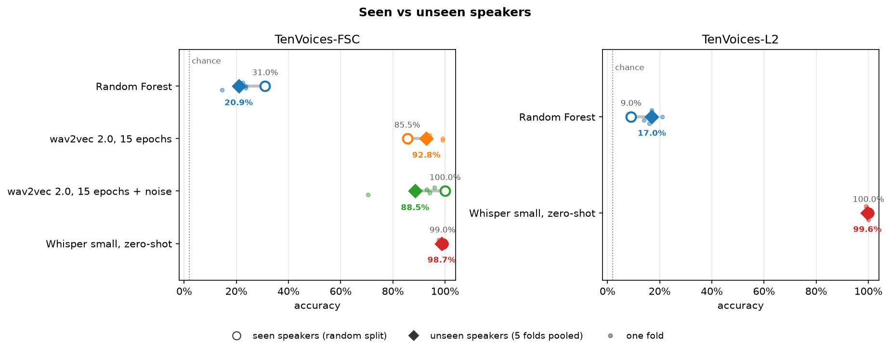
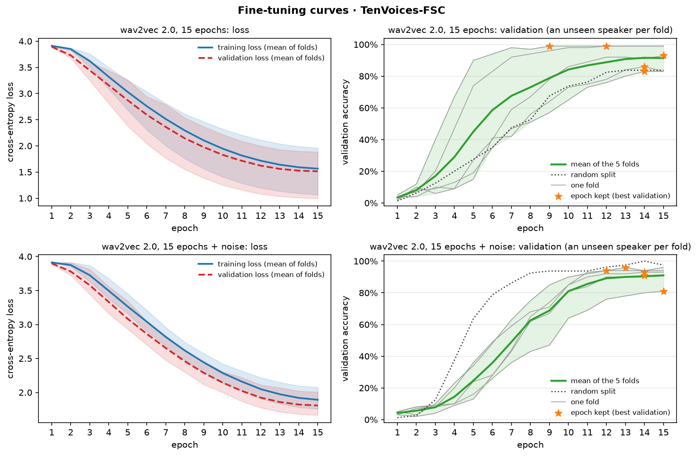
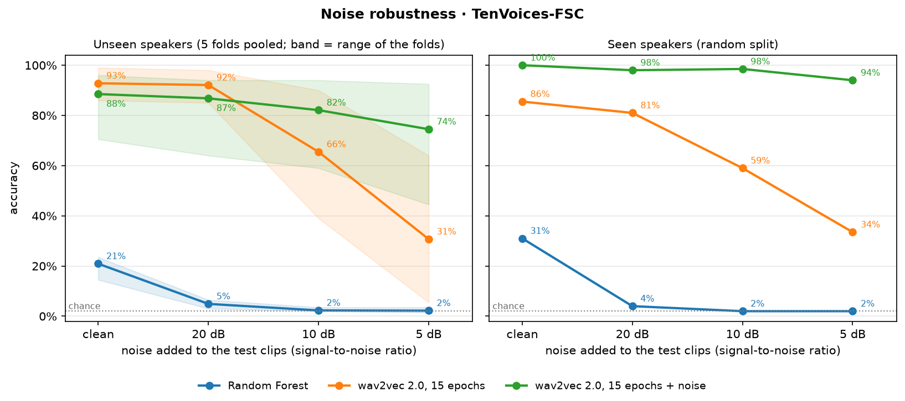
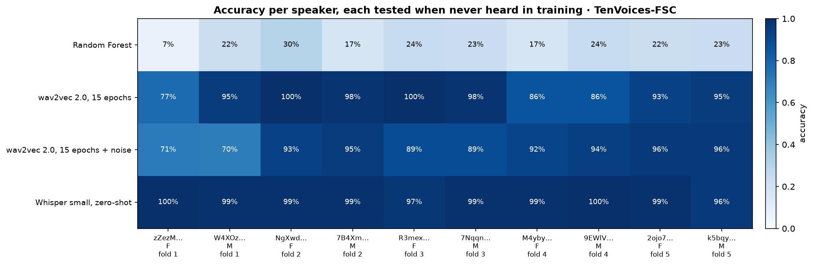
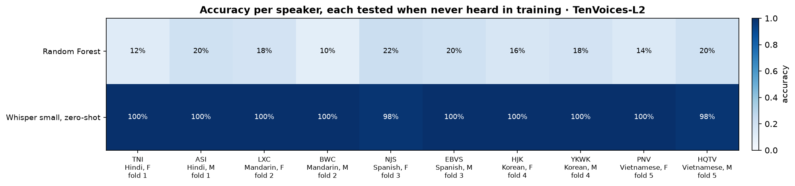
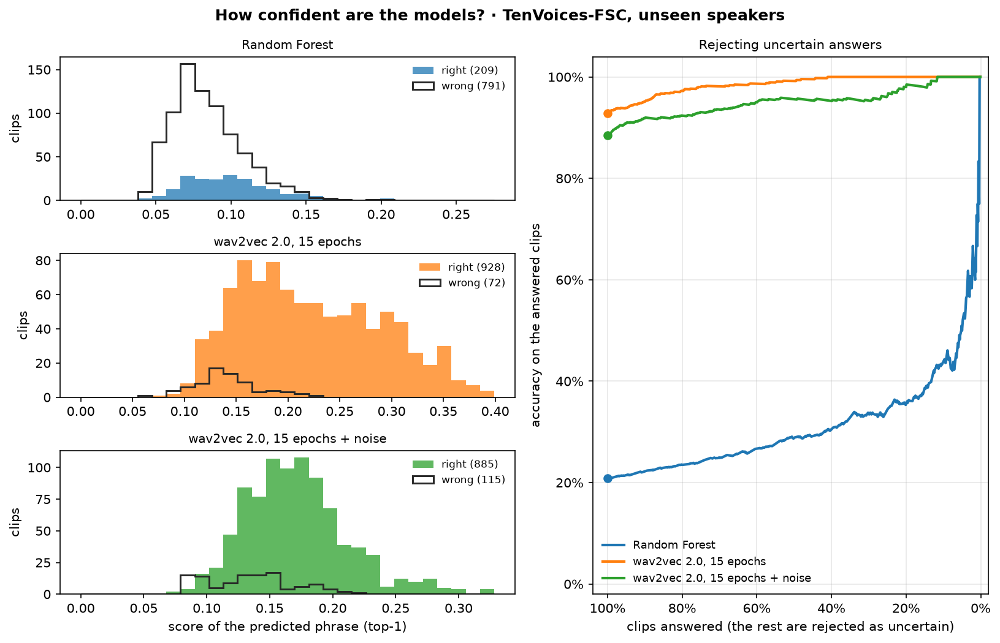
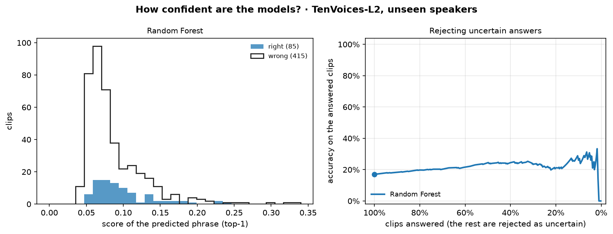
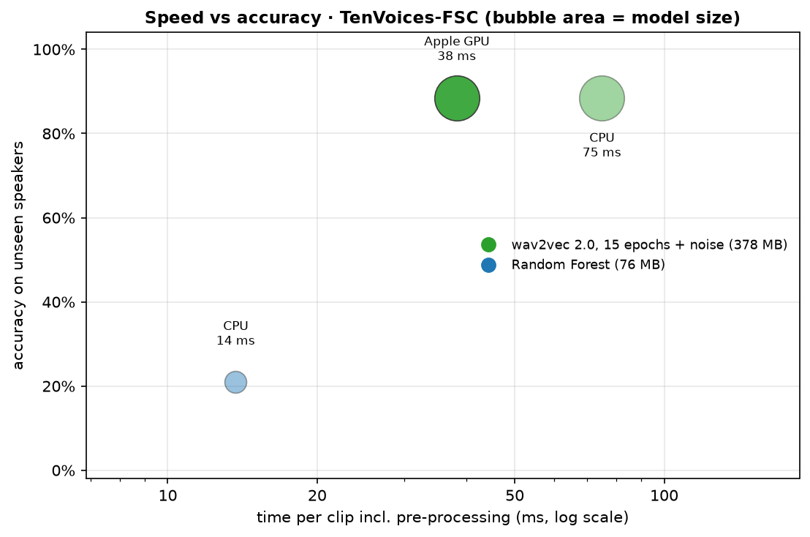
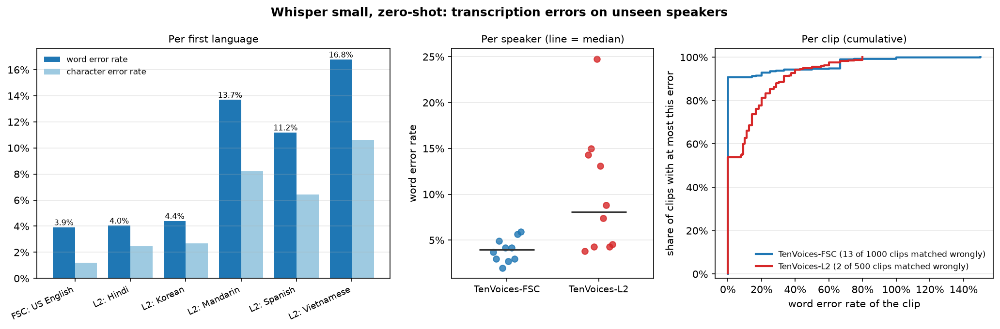

# results/M1_tanvir/: Tanvir's results

Everything Tanvir (M1) ran, in one folder so it never mixes with the other members' runs. The shared scripts write here by themselves (`result_folders` in `configs/config.yaml`).

**Every run in detail, with all its numbers: [RUNS.md](RUNS.md)** (model, how it was trained, every split, accuracy per speaker, confusion matrices; written from the files in this folder by `python -m support.contributions`).

| Path | What |
|---|---|
| `random_forest/{fsc,l2arctic}/` | Random Forest on MFCC features (T11, T47) |
| `w2v2_15ep_noise/fsc/` | wav2vec 2.0 fine-tuned 15 epochs with white-noise augmentation (T15) |
| `w2v2_15ep/fsc/` | wav2vec 2.0 fine-tuned 15 epochs, no noise (T19) |
| `whisper_small/{fsc,l2arctic}/` | Whisper small, zero-shot, matched to the nearest phrase; WER per speaker and first language (T30) |
| `noise/` | Noise tests at 20 / 10 / 5 dB (T21) |
| `benchmark_fsc.csv` | Time per clip and model size (T22) |
| `figures/confusion/` | Confusion matrices of every run (random split and pooled folds) |
| `figures/*.png` | The figures below (T49) |

Each run folder holds `summary.json` (random split, pooled folds, each fold, mean ± std, settings), `predictions_<split>.csv`, and `random/` and `folds/` with metrics, classification report, per-speaker accuracy and confusion matrix.

**Redraw every figure:** `python -m support.figures --folder M1_tanvir` (about 10 s, no GPU). Every figure is drawn from the files in this folder only.

## Figures

### Seen vs unseen speakers

Hollow circle: random split (the test speakers were also heard in training). Diamond: the 5 speaker-independent folds pooled. Small dots: each fold. Fine-tuned wav2vec 2.0 and Whisper stay far above Random Forest on speakers they never heard; one fold (fold 1) is much harder for the noise-trained model.

### Fine-tuning curves

Loss and validation accuracy per epoch for both 15-epoch runs: the mean of the 5 folds with their range, every fold as a thin line, and a star at the epoch that was kept (best validation accuracy). Validation accuracy is still rising near epoch 15, so the kept epoch is late in most folds.

### Noise robustness

The same white noise is added to every test clip for every model. Training with noise keeps the model usable at 5 dB (74.5% vs 30.7% on unseen speakers) at a cost of 4.3 points on clean audio; Random Forest falls to chance level as soon as noise is added.

### Accuracy per speaker

Each speaker is scored by the model of the fold that held them out. On TenVoices-FSC both fold-1 speakers are the hardest for the noise-trained wav2vec 2.0 (71% and 70%). On TenVoices-L2 each fold holds out one first language; Whisper finds the right sentence for nearly every speaker.

### Confidence of the answers

Left: the score of the predicted phrase for right and wrong answers. Right: accuracy on the clips that are still answered when the least confident ones are rejected. wav2vec 2.0's wrong answers get lower scores than its right ones, so rejecting uncertain clips raises its accuracy; the scores are low overall, so they rank answers but are not probabilities. Random Forest's scores separate right from wrong far less. (Whisper gives no score and is not shown.)

### Speed vs accuracy

One clip, including pre-processing, on a MacBook: wav2vec 2.0 takes 38 ms on the Apple GPU and 75 ms on the CPU (378 MB); Random Forest takes 14 ms (76 MB) but is far less accurate.

### Whisper's transcription errors

Word and character error rate per first language, per speaker and per clip, on the unseen-speaker folds. Errors are higher on non-native speech (WER 10.0% on TenVoices-L2 vs 3.9% on TenVoices-FSC; from 4.0% for Hindi to 16.8% for Vietnamese speakers), but phrase matching absorbs most of them. H5 is decided in T24.
