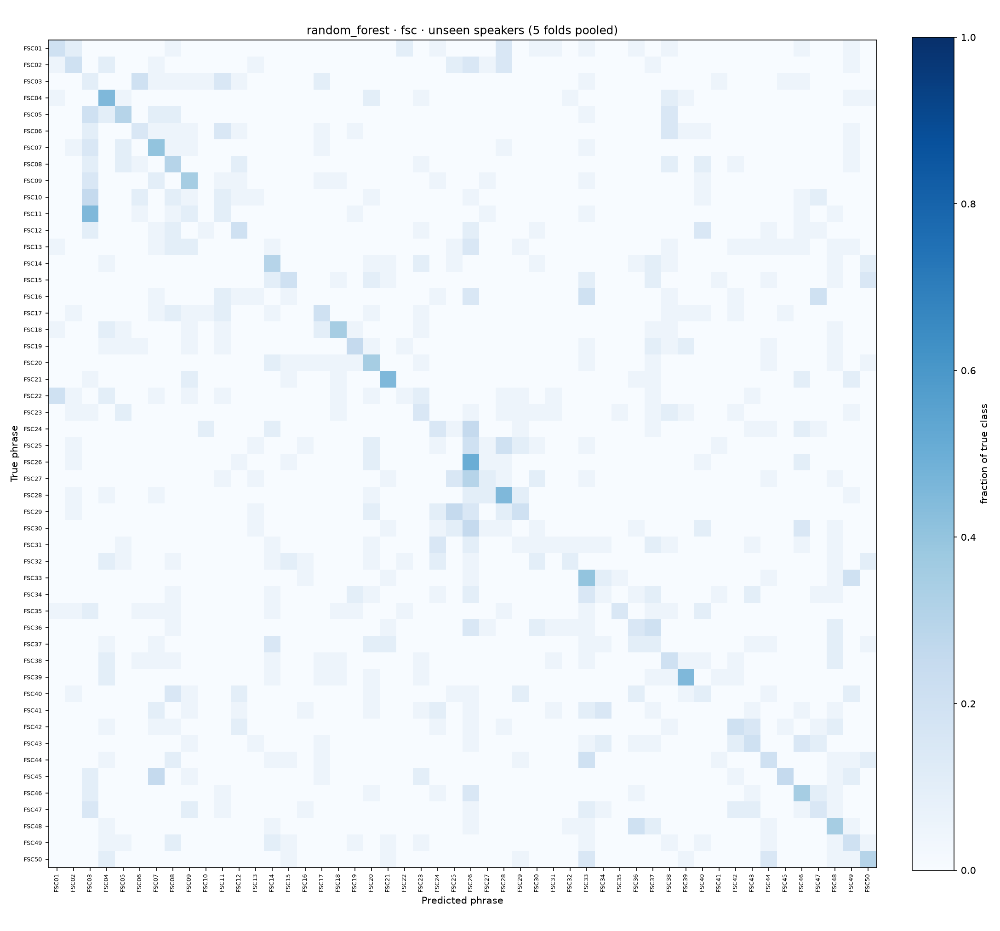
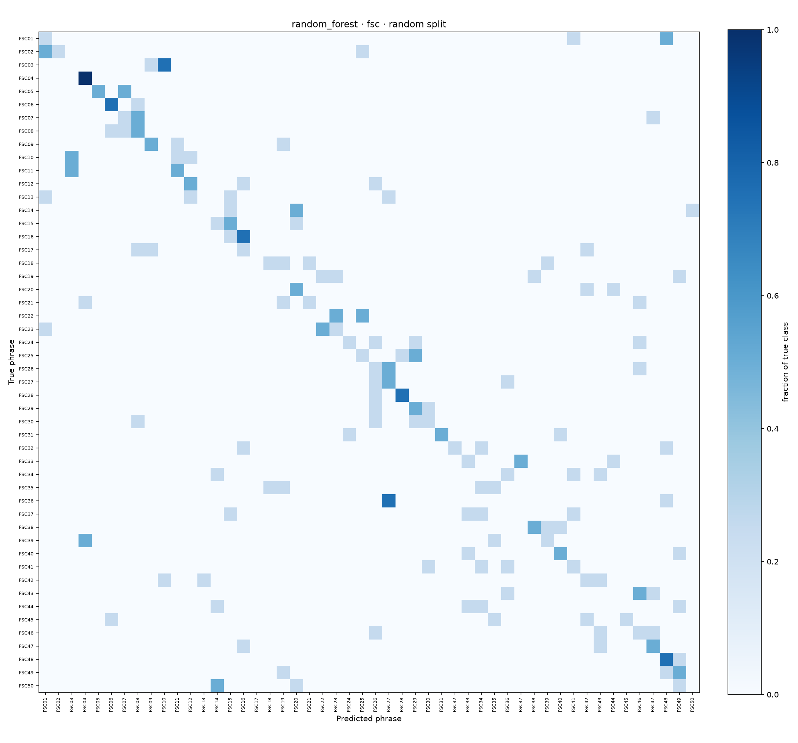
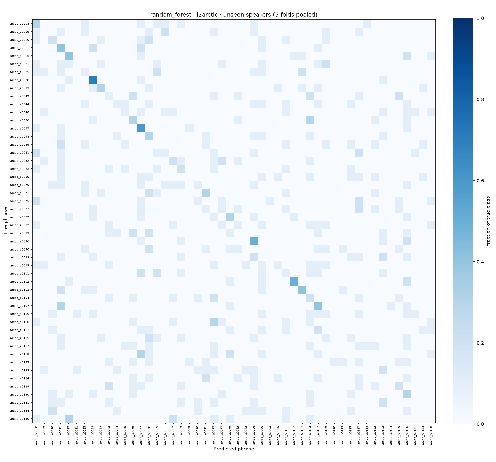
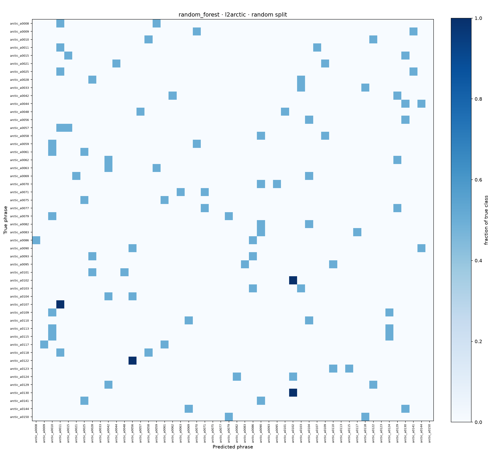
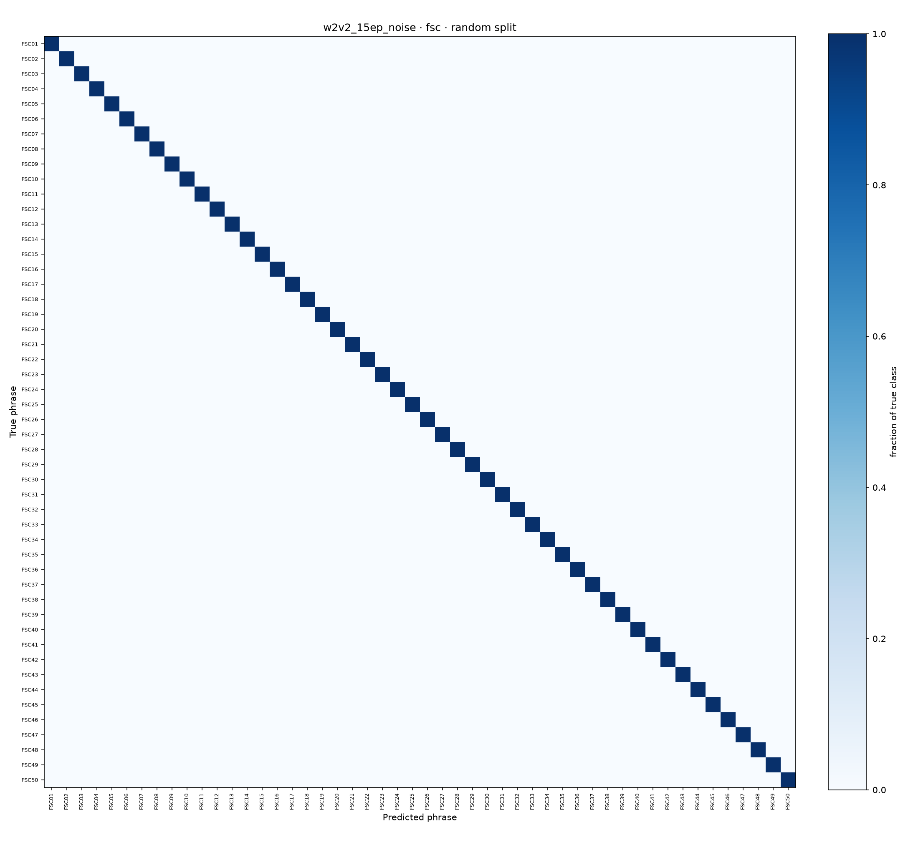
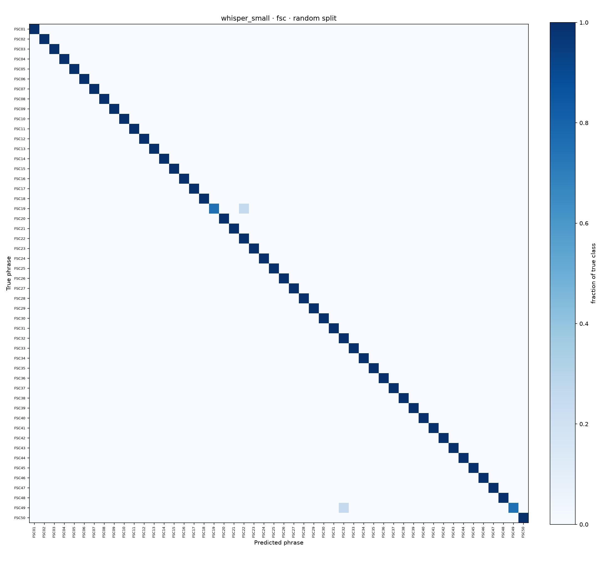
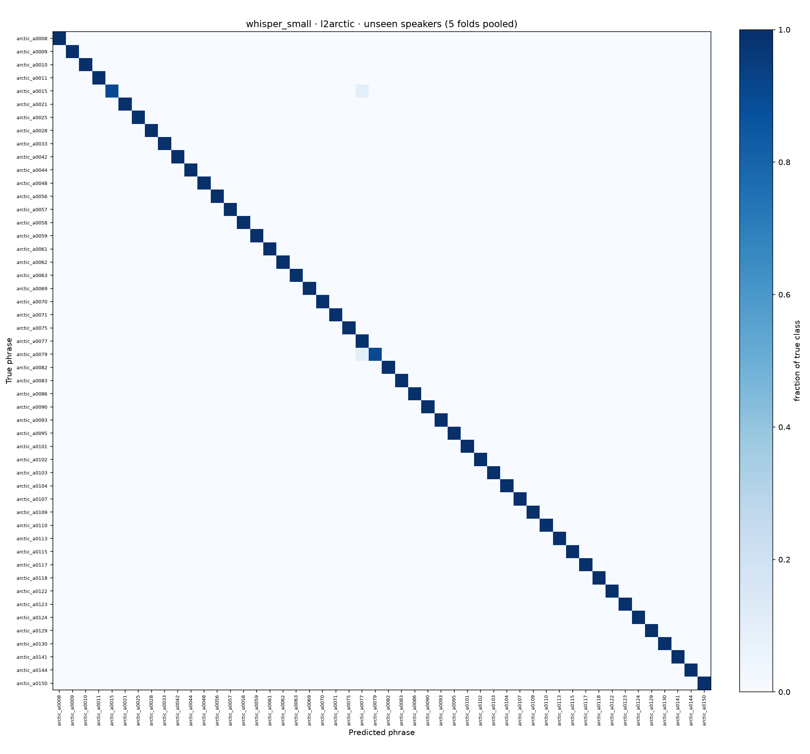
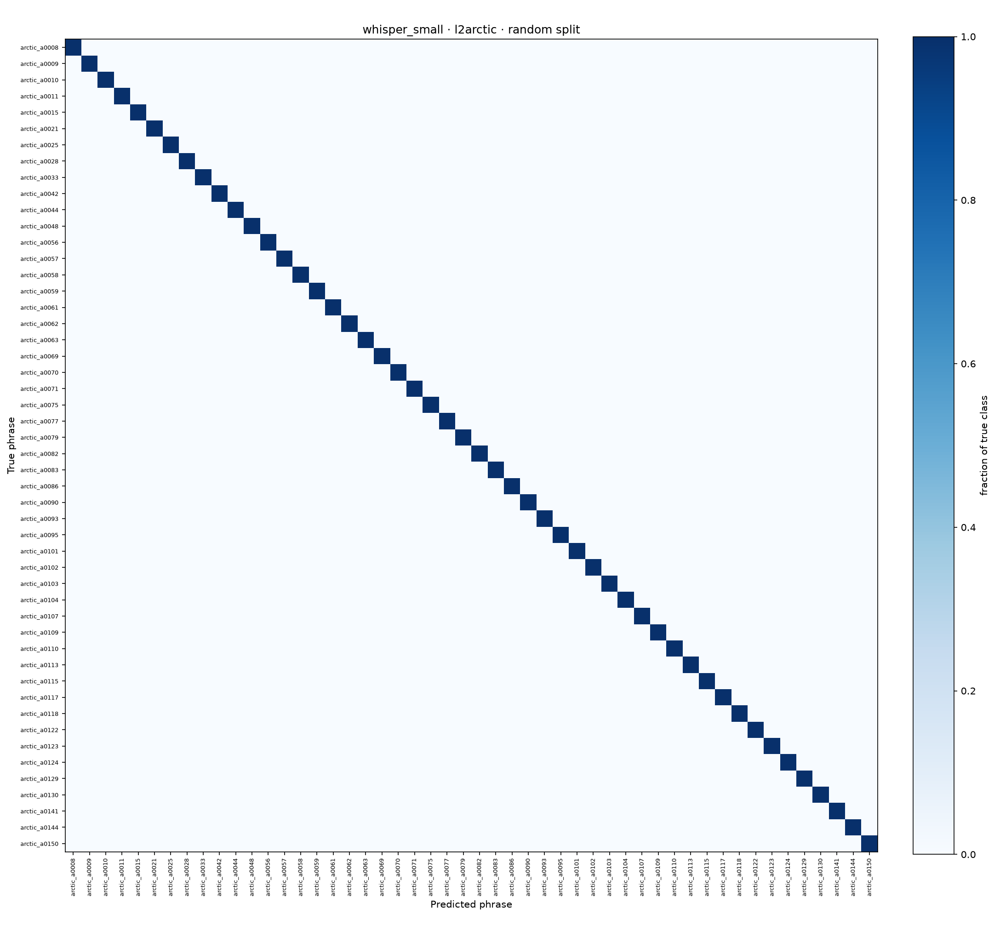

# Tanvir Ahmed (M1): runs and results

Every number on this page is read from the run's files in [results/](../../results/). **Unseen speakers:** speaker-independent 5-fold cross-validation, each fold tests speakers never heard in training (the headline). **Random split:** 80 / 20, the test speakers were also heard in training.

Runs: [Random Forest, TenVoices-FSC](#random-forest--tenvoices-fsc) · [Random Forest, TenVoices-L2](#random-forest--tenvoices-l2) · [wav2vec 2.0, 15 epochs + noise, TenVoices-FSC](#wav2vec-20-15-epochs--noise--tenvoices-fsc) · [wav2vec 2.0, 15 epochs, TenVoices-FSC](#wav2vec-20-15-epochs--tenvoices-fsc) · [Whisper small, zero-shot, TenVoices-FSC](#whisper-small-zero-shot--tenvoices-fsc) · [Whisper small, zero-shot, TenVoices-L2](#whisper-small-zero-shot--tenvoices-l2)

## Random Forest · TenVoices-FSC

| | |
|---|---|
| **Model** | Random Forest on 78 MFCC statistics per clip (13 MFCCs + deltas + delta-deltas, mean and standard deviation; FFT 512, hop 160, 40 mel bands) |
| **How** | Hyper-parameters chosen per split on the validation speakers (best validation accuracy); the choice is in the table below. |
| **Data** | random split 720 / 80 / 200; each fold 700 / 100 / 200 (train / validation / test clips) |
| **Run folder** | [results/M1_tanvir/random_forest/fsc/](../../results/M1_tanvir/random_forest/fsc/) |

| Split | Test clips | Accuracy | Macro F1 | Kept | Validation accuracy |
|---|---:|---:|---:|---|---:|
| Random split (seen speakers) | 200 | 31.0% | 0.299 | max_depth=20, min_samples_leaf=1, n_estimators=300 | 26.2% |
| Fold 1 | 200 | 14.5% | 0.118 | max_depth=None, min_samples_leaf=2, n_estimators=300 | 26.0% |
| Fold 2 | 200 | 23.5% | 0.209 | max_depth=20, min_samples_leaf=2, n_estimators=300 | 16.0% |
| Fold 3 | 200 | 23.5% | 0.202 | max_depth=None, min_samples_leaf=2, n_estimators=300 | 15.0% |
| Fold 4 | 200 | 20.5% | 0.179 | max_depth=None, min_samples_leaf=1, n_estimators=300 | 29.0% |
| Fold 5 | 200 | 22.5% | 0.182 | max_depth=20, min_samples_leaf=1, n_estimators=300 | 9.0% |
| **All folds (unseen speakers)** | 1000 | **20.9%** | **0.199** | fold mean 20.9% ± 3.8 | |

Accuracy per test speaker (each speaker scored by the fold that held it out):

| Speaker | Test clips | Correct | Accuracy |
|---|---:|---:|---:|
| `2ojo7YRL7Gck83Z3` | 100 | 22 | 22.0% |
| `7B4XmNppyrCK977p` | 100 | 17 | 17.0% |
| `7NqqnAOPVVSKnxyv` | 100 | 23 | 23.0% |
| `9EWlVBQo9rtqRYdy` | 100 | 24 | 24.0% |
| `M4ybygBlWqImBn9oZ` | 100 | 17 | 17.0% |
| `NgXwdx5KkZI5GRWa` | 100 | 30 | 30.0% |
| `R3mexpM2YAtdPbL7` | 100 | 24 | 24.0% |
| `W4XOzzNEbrtZz4dW` | 100 | 22 | 22.0% |
| `k5bqyxx2lzIbrlg9` | 100 | 23 | 23.0% |
| `zZezMeg5XvcbRdg3` | 100 | 7 | 7.0% |

Confusion matrices (unseen-speaker folds · random split):

 

## Random Forest · TenVoices-L2

| | |
|---|---|
| **Model** | Random Forest on 78 MFCC statistics per clip (13 MFCCs + deltas + delta-deltas, mean and standard deviation; FFT 512, hop 160, 40 mel bands) |
| **How** | Hyper-parameters chosen per split on the validation speakers (best validation accuracy); the choice is in the table below. |
| **Data** | random split 360 / 40 / 100; each fold 350 / 50 / 100 (train / validation / test clips) |
| **Run folder** | [results/M1_tanvir/random_forest/l2arctic/](../../results/M1_tanvir/random_forest/l2arctic/) |

| Split | Test clips | Accuracy | Macro F1 | Kept | Validation accuracy |
|---|---:|---:|---:|---|---:|
| Random split (seen speakers) | 100 | 9.0% | 0.070 | max_depth=None, min_samples_leaf=1, n_estimators=300 | 12.5% |
| Fold 1 | 100 | 16.0% | 0.092 | max_depth=20, min_samples_leaf=2, n_estimators=300 | 24.0% |
| Fold 2 | 100 | 14.0% | 0.130 | max_depth=None, min_samples_leaf=1, n_estimators=300 | 20.0% |
| Fold 3 | 100 | 21.0% | 0.170 | max_depth=20, min_samples_leaf=1, n_estimators=300 | 10.0% |
| Fold 4 | 100 | 17.0% | 0.133 | max_depth=None, min_samples_leaf=1, n_estimators=300 | 32.0% |
| Fold 5 | 100 | 17.0% | 0.126 | max_depth=20, min_samples_leaf=1, n_estimators=300 | 12.0% |
| **All folds (unseen speakers)** | 500 | **17.0%** | **0.149** | fold mean 17.0% ± 2.5 | |

Accuracy per test speaker (each speaker scored by the fold that held it out):

| Speaker | Test clips | Correct | Accuracy |
|---|---:|---:|---:|
| `ASI` | 50 | 10 | 20.0% |
| `BWC` | 50 | 5 | 10.0% |
| `EBVS` | 50 | 10 | 20.0% |
| `HJK` | 50 | 8 | 16.0% |
| `HQTV` | 50 | 10 | 20.0% |
| `LXC` | 50 | 9 | 18.0% |
| `NJS` | 50 | 11 | 22.0% |
| `PNV` | 50 | 7 | 14.0% |
| `TNI` | 50 | 6 | 12.0% |
| `YKWK` | 50 | 9 | 18.0% |

Confusion matrices (unseen-speaker folds · random split):

 

## wav2vec 2.0, 15 epochs + noise · TenVoices-FSC

| | |
|---|---|
| **Model** | `facebook/wav2vec2-base`, fine-tuned for 15 epochs |
| **How** | white noise added to 50% of the training clips at 5–30 dB SNR; learning rate 3e-05, batch 4 × 2 accumulation steps, 10% warm-up, feature encoder frozen; the epoch with the best validation accuracy is kept; trained on `mps`. |
| **Data** | random split 720 / 80 / 200; each fold 700 / 100 / 200 (train / validation / test clips) |
| **Run folder** | [results/M1_tanvir/w2v2_15ep_noise/fsc/](../../results/M1_tanvir/w2v2_15ep_noise/fsc/) |

| Split | Test clips | Accuracy | Macro F1 | Kept | Validation accuracy |
|---|---:|---:|---:|---|---:|
| Random split (seen speakers) | 200 | 100.0% | 1.000 | epoch 14 | 100.0% |
| Fold 1 | 200 | 70.5% | 0.662 | epoch 15 | 81.0% |
| Fold 2 | 200 | 94.0% | 0.926 | epoch 12 | 94.0% |
| Fold 3 | 200 | 89.0% | 0.863 | epoch 14 | 91.0% |
| Fold 4 | 200 | 93.0% | 0.910 | epoch 14 | 93.0% |
| Fold 5 | 200 | 96.0% | 0.957 | epoch 13 | 96.0% |
| **All folds (unseen speakers)** | 1000 | **88.5%** | **0.881** | fold mean 88.5% ± 10.4 | |

Accuracy per test speaker (each speaker scored by the fold that held it out):

| Speaker | Test clips | Correct | Accuracy |
|---|---:|---:|---:|
| `2ojo7YRL7Gck83Z3` | 100 | 96 | 96.0% |
| `7B4XmNppyrCK977p` | 100 | 95 | 95.0% |
| `7NqqnAOPVVSKnxyv` | 100 | 89 | 89.0% |
| `9EWlVBQo9rtqRYdy` | 100 | 94 | 94.0% |
| `M4ybygBlWqImBn9oZ` | 100 | 92 | 92.0% |
| `NgXwdx5KkZI5GRWa` | 100 | 93 | 93.0% |
| `R3mexpM2YAtdPbL7` | 100 | 89 | 89.0% |
| `W4XOzzNEbrtZz4dW` | 100 | 70 | 70.0% |
| `k5bqyxx2lzIbrlg9` | 100 | 96 | 96.0% |
| `zZezMeg5XvcbRdg3` | 100 | 71 | 71.0% |

Confusion matrices (unseen-speaker folds · random split):

 

## wav2vec 2.0, 15 epochs · TenVoices-FSC

| | |
|---|---|
| **Model** | `facebook/wav2vec2-base`, fine-tuned for 15 epochs |
| **How** | no noise augmentation; learning rate 3e-05, batch 4 × 2 accumulation steps, 10% warm-up, feature encoder frozen; the epoch with the best validation accuracy is kept; trained on `mps`. |
| **Data** | random split 720 / 80 / 200; each fold 700 / 100 / 200 (train / validation / test clips) |
| **Run folder** | [results/M1_tanvir/w2v2_15ep/fsc/](../../results/M1_tanvir/w2v2_15ep/fsc/) |

| Split | Test clips | Accuracy | Macro F1 | Kept | Validation accuracy |
|---|---:|---:|---:|---|---:|
| Random split (seen speakers) | 200 | 85.5% | 0.824 | epoch 13 | 83.8% |
| Fold 1 | 200 | 86.0% | 0.849 | epoch 15 | 93.0% |
| Fold 2 | 200 | 99.0% | 0.990 | epoch 12 | 99.0% |
| Fold 3 | 200 | 99.0% | 0.990 | epoch 9 | 99.0% |
| Fold 4 | 200 | 86.0% | 0.818 | epoch 14 | 83.0% |
| Fold 5 | 200 | 94.0% | 0.928 | epoch 14 | 86.0% |
| **All folds (unseen speakers)** | 1000 | **92.8%** | **0.927** | fold mean 92.8% ± 6.5 | |

Accuracy per test speaker (each speaker scored by the fold that held it out):

| Speaker | Test clips | Correct | Accuracy |
|---|---:|---:|---:|
| `2ojo7YRL7Gck83Z3` | 100 | 93 | 93.0% |
| `7B4XmNppyrCK977p` | 100 | 98 | 98.0% |
| `7NqqnAOPVVSKnxyv` | 100 | 98 | 98.0% |
| `9EWlVBQo9rtqRYdy` | 100 | 86 | 86.0% |
| `M4ybygBlWqImBn9oZ` | 100 | 86 | 86.0% |
| `NgXwdx5KkZI5GRWa` | 100 | 100 | 100.0% |
| `R3mexpM2YAtdPbL7` | 100 | 100 | 100.0% |
| `W4XOzzNEbrtZz4dW` | 100 | 95 | 95.0% |
| `k5bqyxx2lzIbrlg9` | 100 | 95 | 95.0% |
| `zZezMeg5XvcbRdg3` | 100 | 77 | 77.0% |

Confusion matrices (unseen-speaker folds · random split):

 

## Whisper small, zero-shot · TenVoices-FSC

| | |
|---|---|
| **Model** | `openai/whisper-small`, zero-shot: it transcribes each clip and the transcript is matched to the nearest of the phrases |
| **How** | No training on our data; only the test clips are transcribed. |
| **Data** | test clips only: 200 (random split), 1000 (5 folds) |
| **Run folder** | [results/M1_tanvir/whisper_small/fsc/](../../results/M1_tanvir/whisper_small/fsc/) |

| Split | Test clips | Accuracy | Macro F1 | Kept | Validation accuracy | Word error rate |
|---|---:|---:|---:|---|---:|---:|
| Random split (seen speakers) | 200 | 99.0% | 0.990 | – | – | 3.7% |
| Fold 1 | 200 | 99.5% | 0.995 | – | – | 4.4% |
| Fold 2 | 200 | 99.0% | 0.990 | – | – | 2.8% |
| Fold 3 | 200 | 98.0% | 0.977 | – | – | 4.6% |
| Fold 4 | 200 | 99.5% | 0.995 | – | – | 3.1% |
| Fold 5 | 200 | 97.5% | 0.972 | – | – | 4.7% |
| **All folds (unseen speakers)** | 1000 | **98.7%** | **0.987** | fold mean 98.7% ± 0.9 | | 3.9% |

Accuracy per test speaker (each speaker scored by the fold that held it out):

| Speaker | Test clips | Correct | Accuracy |
|---|---:|---:|---:|
| `2ojo7YRL7Gck83Z3` | 100 | 99 | 99.0% |
| `7B4XmNppyrCK977p` | 100 | 99 | 99.0% |
| `7NqqnAOPVVSKnxyv` | 100 | 99 | 99.0% |
| `9EWlVBQo9rtqRYdy` | 100 | 100 | 100.0% |
| `M4ybygBlWqImBn9oZ` | 100 | 99 | 99.0% |
| `NgXwdx5KkZI5GRWa` | 100 | 99 | 99.0% |
| `R3mexpM2YAtdPbL7` | 100 | 97 | 97.0% |
| `W4XOzzNEbrtZz4dW` | 100 | 99 | 99.0% |
| `k5bqyxx2lzIbrlg9` | 100 | 96 | 96.0% |
| `zZezMeg5XvcbRdg3` | 100 | 100 | 100.0% |

Confusion matrices (unseen-speaker folds · random split):

 

## Whisper small, zero-shot · TenVoices-L2

| | |
|---|---|
| **Model** | `openai/whisper-small`, zero-shot: it transcribes each clip and the transcript is matched to the nearest of the phrases |
| **How** | No training on our data; only the test clips are transcribed. |
| **Data** | test clips only: 100 (random split), 500 (5 folds) |
| **Run folder** | [results/M1_tanvir/whisper_small/l2arctic/](../../results/M1_tanvir/whisper_small/l2arctic/) |

| Split | Test clips | Accuracy | Macro F1 | Kept | Validation accuracy | Word error rate |
|---|---:|---:|---:|---|---:|---:|
| Random split (seen speakers) | 100 | 100.0% | 1.000 | – | – | 8.6% |
| Fold 1 | 100 | 100.0% | 1.000 | – | – | 4.0% |
| Fold 2 | 100 | 100.0% | 1.000 | – | – | 13.7% |
| Fold 3 | 100 | 99.0% | 0.989 | – | – | 11.2% |
| Fold 4 | 100 | 100.0% | 1.000 | – | – | 4.4% |
| Fold 5 | 100 | 99.0% | 0.989 | – | – | 16.8% |
| **All folds (unseen speakers)** | 500 | **99.6%** | **0.996** | fold mean 99.6% ± 0.5 | | 10.0% |

Accuracy per test speaker (each speaker scored by the fold that held it out):

| Speaker | Test clips | Correct | Accuracy |
|---|---:|---:|---:|
| `ASI` | 50 | 50 | 100.0% |
| `BWC` | 50 | 50 | 100.0% |
| `EBVS` | 50 | 50 | 100.0% |
| `HJK` | 50 | 50 | 100.0% |
| `HQTV` | 50 | 49 | 98.0% |
| `LXC` | 50 | 50 | 100.0% |
| `NJS` | 50 | 49 | 98.0% |
| `PNV` | 50 | 50 | 100.0% |
| `TNI` | 50 | 50 | 100.0% |
| `YKWK` | 50 | 50 | 100.0% |

Confusion matrices (unseen-speaker folds · random split):

 

---

Written by `python -m support.contributions` from the result files; do not edit by hand. Back to [Tanvir Ahmed](../../contributions/M1_tanvir.md) · [who did what](../../contributions/README.md)
