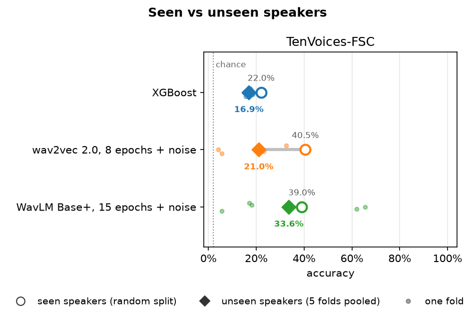
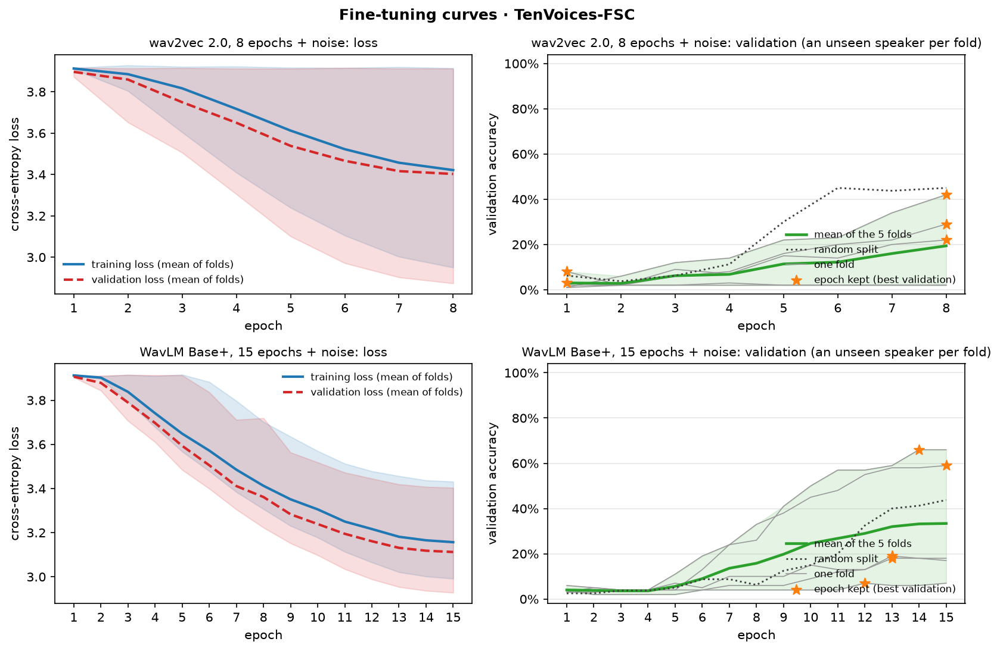
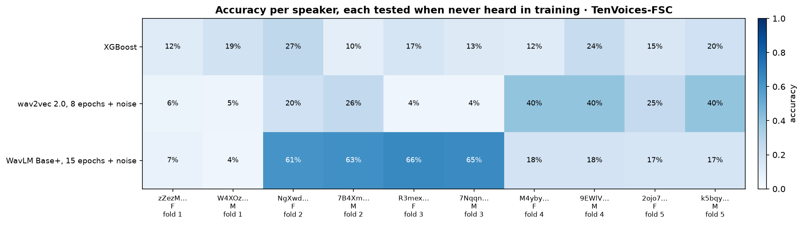
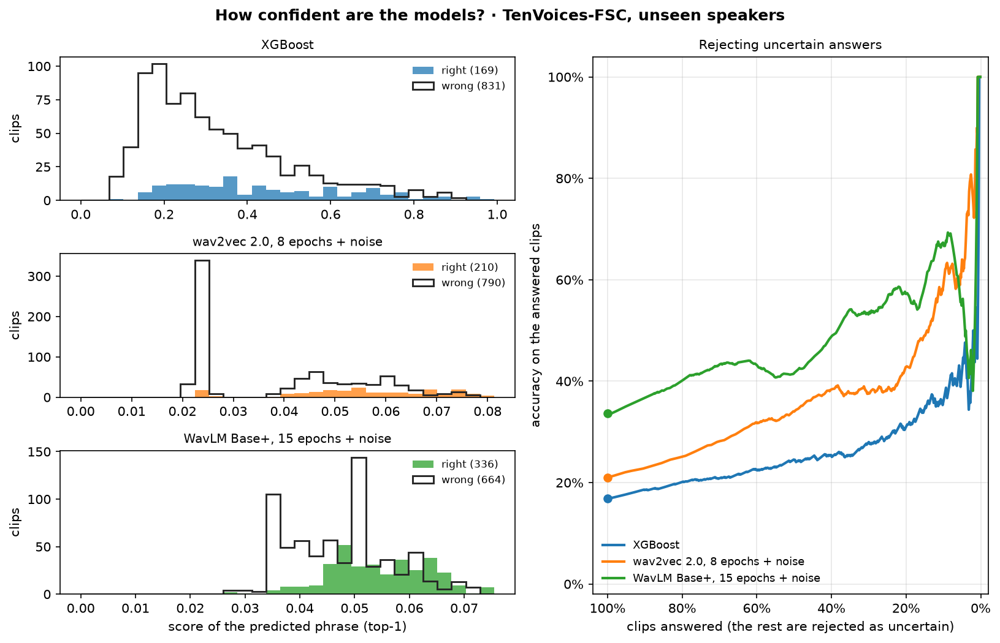

# results/M2_rabbi/: Rabbi's results

Everything Md. Shahriar Rakib Rabbi (M2) ran, in one folder so it never mixes with the other members' runs. The shared scripts write here by themselves (`result_folders` in `configs/config.yaml`).

**Every run in detail, with all its numbers: [RUNS.md](RUNS.md)** (model, how it was trained, every split, accuracy per speaker, confusion matrices; written from the files in this folder by `python -m support.contributions`).

| Path | What |
|---|---|
| `xgboost/fsc/` | XGBoost on MFCC features (T12) |
| `w2v2_8ep_noise/fsc/` | wav2vec 2.0 fine-tuned 8 epochs with white-noise augmentation (T16) |
| `wavlm_15ep_noise/fsc/` | WavLM Base+ fine-tuned 15 epochs with white-noise augmentation (T44) |
| `figures/confusion/` | Confusion matrices of every run (random split and pooled folds) |
| `figures/*.png` | The figures below |

Each run folder holds `summary.json` (random split, pooled folds, each fold, mean ± std, settings), `predictions_<split>.csv`, and `random/` and `folds/` with metrics, classification report, per-speaker accuracy and confusion matrix.

**Redraw every figure:** `python -m support.figures --folder M2_rabbi` (about 10 s, no GPU). Every figure is drawn from the files in this folder only.

## Figures

### Seen vs unseen speakers

Hollow circle: random split (the test speakers were also heard in training). Diamond: the 5 speaker-independent folds pooled. Small dots: each fold.

### Fine-tuning curves

Loss and validation accuracy per epoch for both fine-tuning runs: the mean of the 5 folds with their range, every fold as a thin line, the random split dotted, and a star at the epoch that was kept (best validation accuracy).

### Accuracy per speaker

Each speaker is scored by the model of the fold that held them out.

### Confidence of the answers

Left: the score of the predicted phrase for right and wrong answers. Right: accuracy on the clips that are still answered when the least confident ones are rejected.
