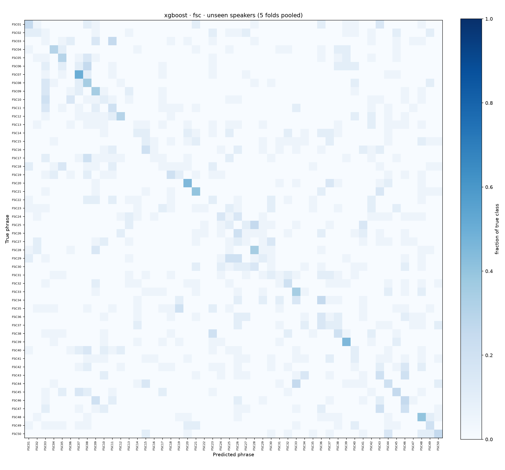
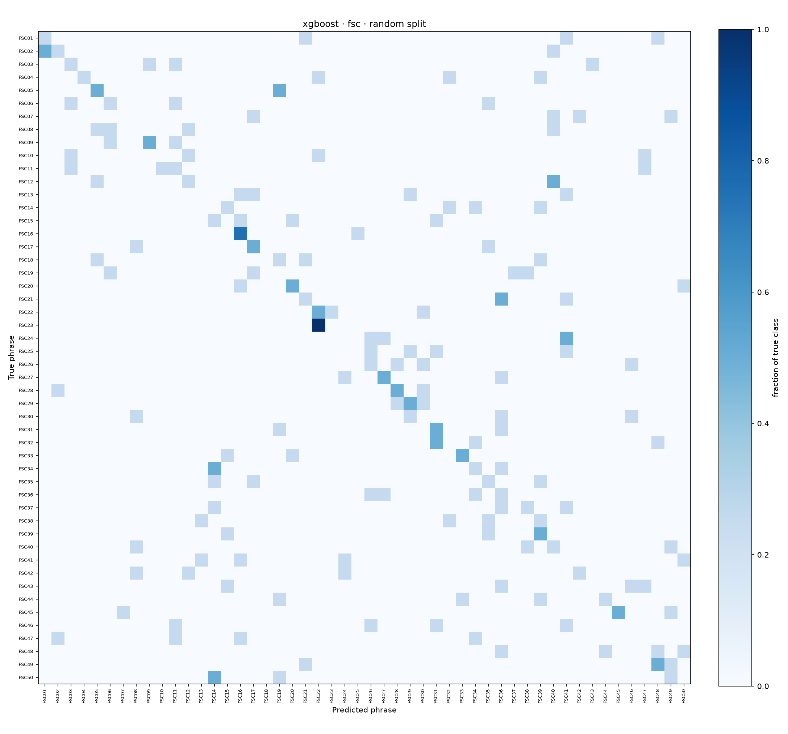
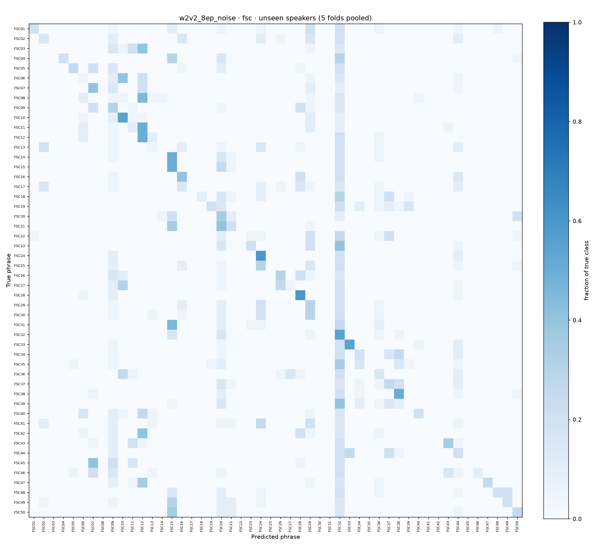
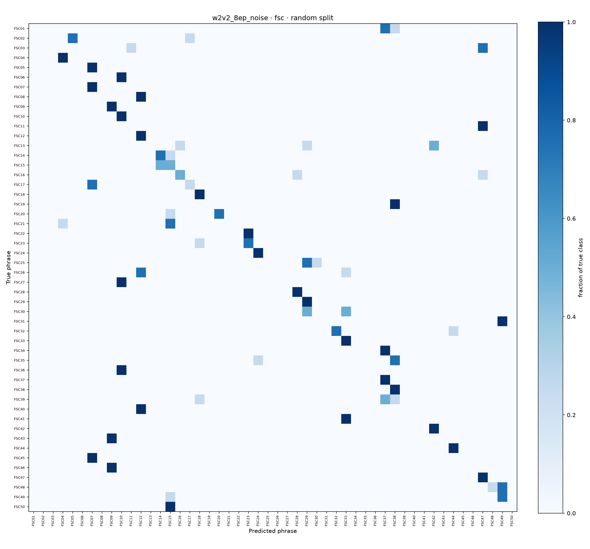
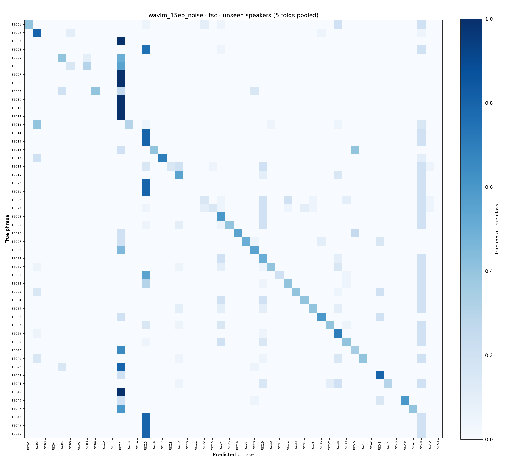
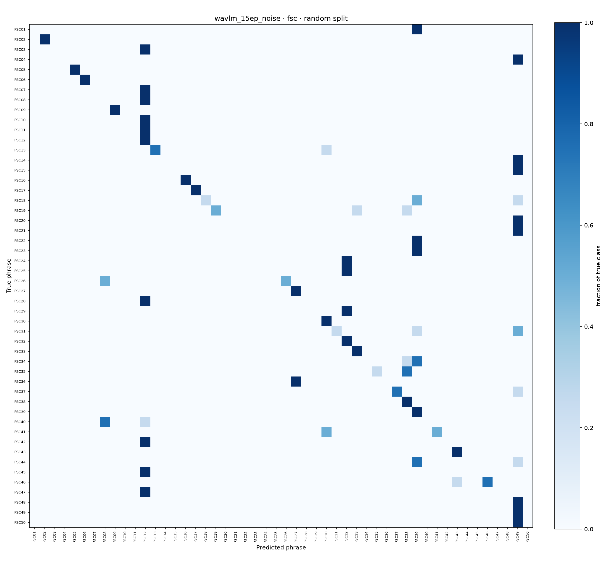

# Md. Shahriar Rakib Rabbi (M2): runs and results

Every number on this page is read from the run's files in [results/](../../results/). **Unseen speakers:** speaker-independent 5-fold cross-validation, each fold tests speakers never heard in training (the headline). **Random split:** 80 / 20, the test speakers were also heard in training.

Runs: [XGBoost, TenVoices-FSC](#xgboost--tenvoices-fsc) · [wav2vec 2.0, 8 epochs + noise, TenVoices-FSC](#wav2vec-20-8-epochs--noise--tenvoices-fsc) · [WavLM Base+, 15 epochs + noise, TenVoices-FSC](#wavlm-base-15-epochs--noise--tenvoices-fsc)

## XGBoost · TenVoices-FSC

| | |
|---|---|
| **Model** | XGBoost on 78 MFCC statistics per clip (13 MFCCs + deltas + delta-deltas, mean and standard deviation; FFT 512, hop 160, 40 mel bands) |
| **How** | Hyper-parameters chosen per split on the validation speakers (best validation accuracy); the choice is in the table below. |
| **Data** | random split 720 / 80 / 200; each fold 700 / 100 / 200 (train / validation / test clips) |
| **Run folder** | [results/M2_rabbi/xgboost/fsc/](../../results/M2_rabbi/xgboost/fsc/) |

| Split | Test clips | Accuracy | Macro F1 | Kept | Validation accuracy |
|---|---:|---:|---:|---|---:|
| Random split (seen speakers) | 200 | 22.0% | 0.208 | learning_rate=0.3, max_depth=6, n_estimators=300 | 20.0% |
| Fold 1 | 200 | 15.5% | 0.122 | learning_rate=0.3, max_depth=4, n_estimators=300 | 23.0% |
| Fold 2 | 200 | 18.5% | 0.169 | learning_rate=0.1, max_depth=6, n_estimators=300 | 17.0% |
| Fold 3 | 200 | 15.0% | 0.127 | learning_rate=0.1, max_depth=4, n_estimators=300 | 12.0% |
| Fold 4 | 200 | 18.0% | 0.143 | learning_rate=0.1, max_depth=4, n_estimators=300 | 24.0% |
| Fold 5 | 200 | 17.5% | 0.151 | learning_rate=0.1, max_depth=6, n_estimators=300 | 9.0% |
| **All folds (unseen speakers)** | 1000 | **16.9%** | **0.158** | fold mean 16.9% ± 1.6 | |

Accuracy per test speaker (each speaker scored by the fold that held it out):

| Speaker | Test clips | Correct | Accuracy |
|---|---:|---:|---:|
| `2ojo7YRL7Gck83Z3` | 100 | 15 | 15.0% |
| `7B4XmNppyrCK977p` | 100 | 10 | 10.0% |
| `7NqqnAOPVVSKnxyv` | 100 | 13 | 13.0% |
| `9EWlVBQo9rtqRYdy` | 100 | 24 | 24.0% |
| `M4ybygBlWqImBn9oZ` | 100 | 12 | 12.0% |
| `NgXwdx5KkZI5GRWa` | 100 | 27 | 27.0% |
| `R3mexpM2YAtdPbL7` | 100 | 17 | 17.0% |
| `W4XOzzNEbrtZz4dW` | 100 | 19 | 19.0% |
| `k5bqyxx2lzIbrlg9` | 100 | 20 | 20.0% |
| `zZezMeg5XvcbRdg3` | 100 | 12 | 12.0% |

Confusion matrices (unseen-speaker folds · random split):

 

## wav2vec 2.0, 8 epochs + noise · TenVoices-FSC

| | |
|---|---|
| **Model** | `facebook/wav2vec2-base`, fine-tuned for 8 epochs |
| **How** | white noise added to 50% of the training clips at 5–30 dB SNR; learning rate 3e-05, batch 4 × 2 accumulation steps, 10% warm-up, feature encoder frozen; the epoch with the best validation accuracy is kept; trained on `cuda`. |
| **Data** | random split 720 / 80 / 200; each fold 700 / 100 / 200 (train / validation / test clips) |
| **Run folder** | [results/M2_rabbi/w2v2_8ep_noise/fsc/](../../results/M2_rabbi/w2v2_8ep_noise/fsc/) |

| Split | Test clips | Accuracy | Macro F1 | Kept | Validation accuracy |
|---|---:|---:|---:|---|---:|
| Random split (seen speakers) | 200 | 40.5% | 0.287 | epoch 6 | 45.0% |
| Fold 1 | 200 | 5.5% | 0.019 | epoch 1 | 8.0% |
| Fold 2 | 200 | 23.0% | 0.150 | epoch 8 | 29.0% |
| Fold 3 | 200 | 4.0% | 0.009 | epoch 1 | 3.0% |
| Fold 4 | 200 | 40.0% | 0.305 | epoch 8 | 42.0% |
| Fold 5 | 200 | 32.5% | 0.236 | epoch 8 | 22.0% |
| **All folds (unseen speakers)** | 1000 | **21.0%** | **0.198** | fold mean 21.0% ± 16.0 | |

Accuracy per test speaker (each speaker scored by the fold that held it out):

| Speaker | Test clips | Correct | Accuracy |
|---|---:|---:|---:|
| `2ojo7YRL7Gck83Z3` | 100 | 25 | 25.0% |
| `7B4XmNppyrCK977p` | 100 | 26 | 26.0% |
| `7NqqnAOPVVSKnxyv` | 100 | 4 | 4.0% |
| `9EWlVBQo9rtqRYdy` | 100 | 40 | 40.0% |
| `M4ybygBlWqImBn9oZ` | 100 | 40 | 40.0% |
| `NgXwdx5KkZI5GRWa` | 100 | 20 | 20.0% |
| `R3mexpM2YAtdPbL7` | 100 | 4 | 4.0% |
| `W4XOzzNEbrtZz4dW` | 100 | 5 | 5.0% |
| `k5bqyxx2lzIbrlg9` | 100 | 40 | 40.0% |
| `zZezMeg5XvcbRdg3` | 100 | 6 | 6.0% |

Confusion matrices (unseen-speaker folds · random split):

 

## WavLM Base+, 15 epochs + noise · TenVoices-FSC

| | |
|---|---|
| **Model** | `microsoft/wavlm-base-plus`, fine-tuned for 15 epochs |
| **How** | white noise added to 50% of the training clips at 5–30 dB SNR; learning rate 3e-05, batch 4 × 2 accumulation steps, 10% warm-up, feature encoder frozen; the epoch with the best validation accuracy is kept; trained on `cuda`. |
| **Data** | random split 720 / 80 / 200; each fold 700 / 100 / 200 (train / validation / test clips) |
| **Run folder** | [results/M2_rabbi/wavlm_15ep_noise/fsc/](../../results/M2_rabbi/wavlm_15ep_noise/fsc/) |

| Split | Test clips | Accuracy | Macro F1 | Kept | Validation accuracy |
|---|---:|---:|---:|---|---:|
| Random split (seen speakers) | 200 | 39.0% | 0.332 | epoch 15 | 43.8% |
| Fold 1 | 200 | 5.5% | 0.023 | epoch 12 | 7.0% |
| Fold 2 | 200 | 62.0% | 0.578 | epoch 15 | 59.0% |
| Fold 3 | 200 | 65.5% | 0.608 | epoch 14 | 66.0% |
| Fold 4 | 200 | 18.0% | 0.094 | epoch 13 | 19.0% |
| Fold 5 | 200 | 17.0% | 0.102 | epoch 13 | 18.0% |
| **All folds (unseen speakers)** | 1000 | **33.6%** | **0.354** | fold mean 33.6% ± 28.0 | |

Accuracy per test speaker (each speaker scored by the fold that held it out):

| Speaker | Test clips | Correct | Accuracy |
|---|---:|---:|---:|
| `2ojo7YRL7Gck83Z3` | 100 | 17 | 17.0% |
| `7B4XmNppyrCK977p` | 100 | 63 | 63.0% |
| `7NqqnAOPVVSKnxyv` | 100 | 65 | 65.0% |
| `9EWlVBQo9rtqRYdy` | 100 | 18 | 18.0% |
| `M4ybygBlWqImBn9oZ` | 100 | 18 | 18.0% |
| `NgXwdx5KkZI5GRWa` | 100 | 61 | 61.0% |
| `R3mexpM2YAtdPbL7` | 100 | 66 | 66.0% |
| `W4XOzzNEbrtZz4dW` | 100 | 4 | 4.0% |
| `k5bqyxx2lzIbrlg9` | 100 | 17 | 17.0% |
| `zZezMeg5XvcbRdg3` | 100 | 7 | 7.0% |

Confusion matrices (unseen-speaker folds · random split):

 

---

Written by `python -m support.contributions` from the result files; do not edit by hand. Back to [Md. Shahriar Rakib Rabbi](../../contributions/M2_rabbi.md) · [who did what](../../contributions/README.md)
