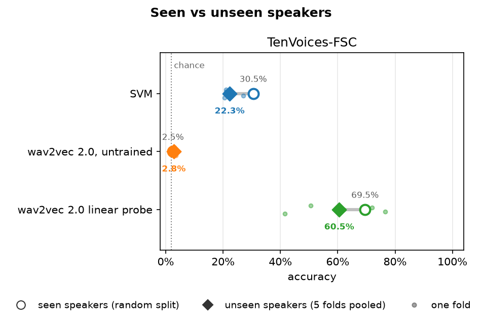
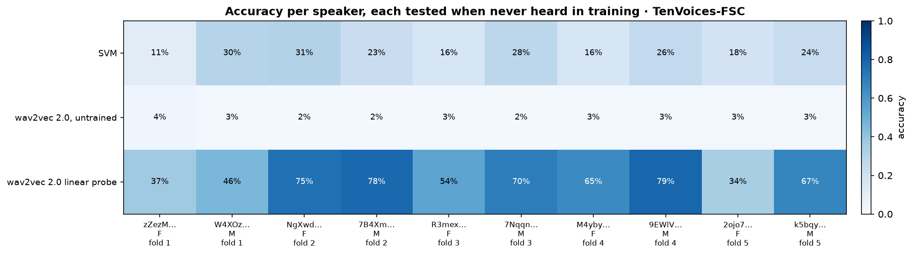
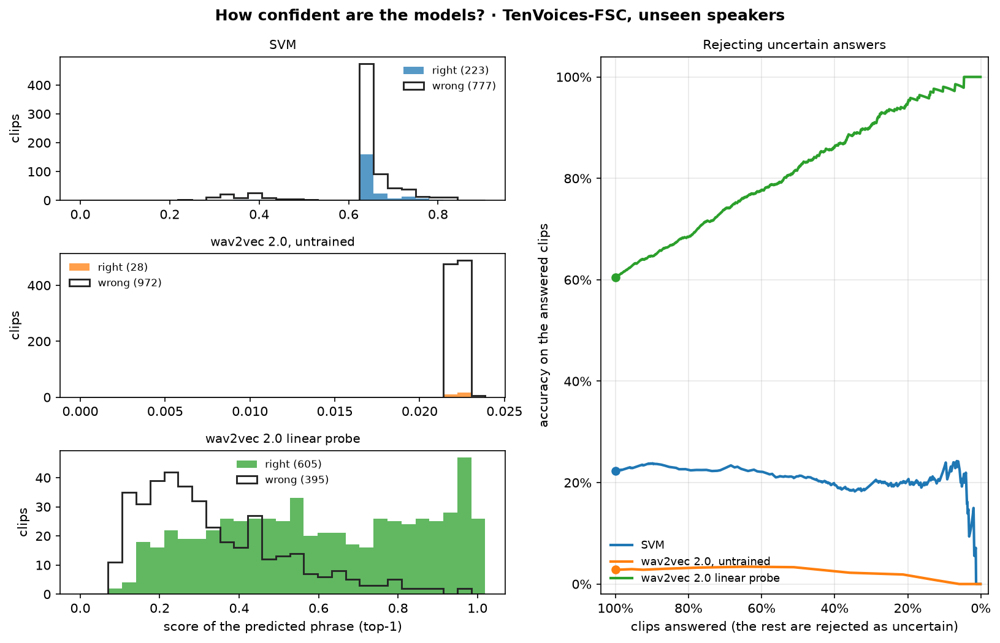

# results/M4_shafil/: Shafil's results

Everything Shafil Ahmed (M4) ran, in one folder so it never mixes with the other members' runs. The shared scripts write here by themselves (`result_folders` in `configs/config.yaml`).

**Every run in detail, with all its numbers: [RUNS.md](RUNS.md)** (model, how it was trained, every split, accuracy per speaker, confusion matrices; written from the files in this folder by `python -m support.contributions`).

| Path | What |
|---|---|
| `svm/fsc/` | SVM on MFCC features (T14) |
| `w2v2_untrained/fsc/` | wav2vec 2.0 with an untrained classification head: the baseline (T18) |
| `w2v2_probe/fsc/` | Linear probe: logistic regression on frozen wav2vec 2.0 features (T46) |
| `figures/confusion/` | Confusion matrices of every run (random split and pooled folds) |
| `figures/*.png` | The figures below |

Each run folder holds `summary.json` (random split, pooled folds, each fold, mean ± std, settings), `predictions_<split>.csv`, and `random/` and `folds/` with metrics, classification report, per-speaker accuracy and confusion matrix. The demo check on Shafil's own voice (T23) is in [`../demo_check/`](../demo_check/), where `support.presentation` reads it.

**Redraw every figure:** `python -m support.figures --folder M4_shafil` (about 10 s, no GPU). Every figure is drawn from the files in this folder only.

## Figures

### Seen vs unseen speakers

Hollow circle: random split (the test speakers were also heard in training). Diamond: the 5 speaker-independent folds pooled. Small dots: each fold.

### Accuracy per speaker

Each speaker is scored by the model of the fold that held them out.

### Confidence of the answers

Left: the score of the predicted phrase for right and wrong answers. Right: accuracy on the clips that are still answered when the least confident ones are rejected.
