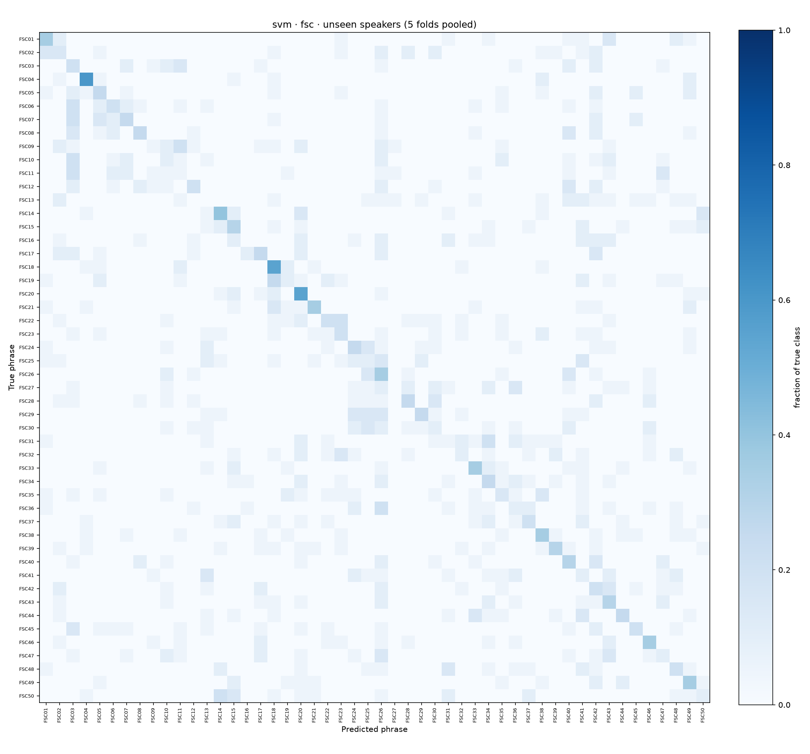
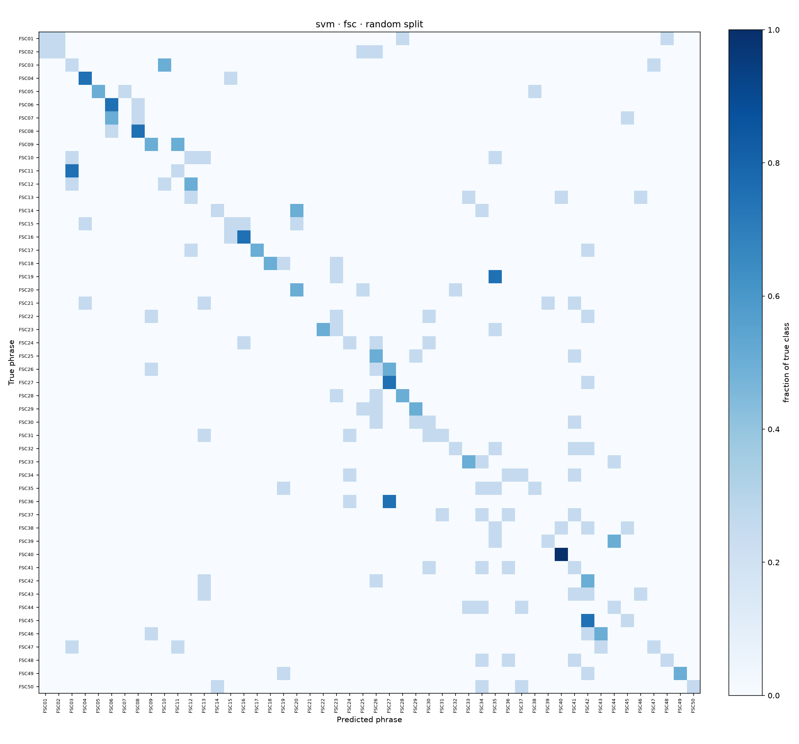
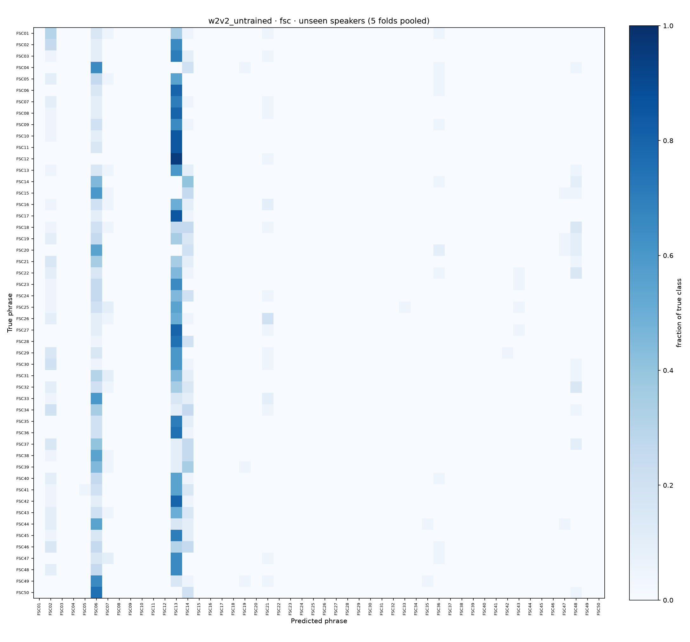
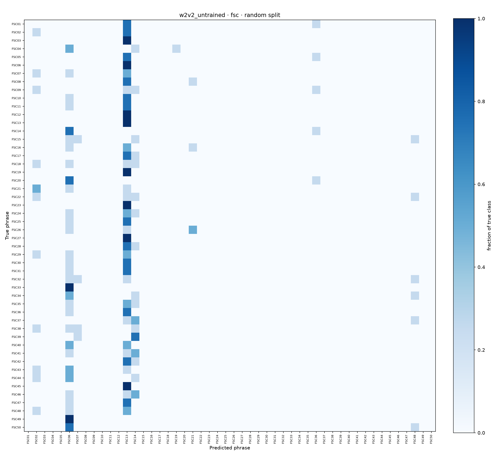
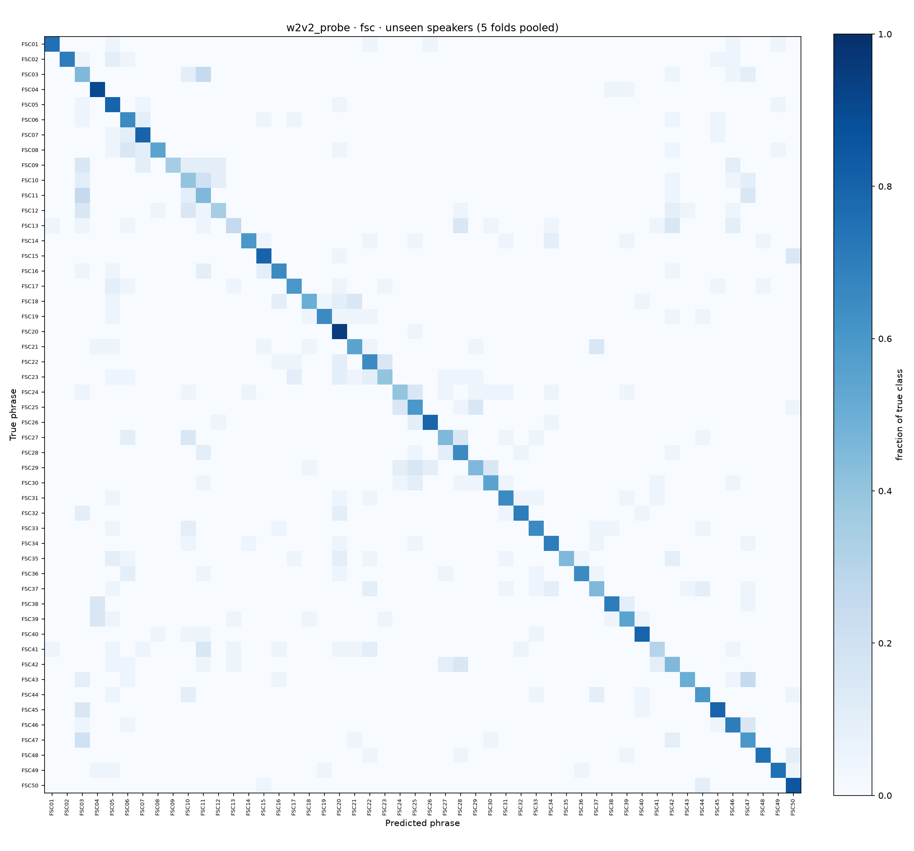

# Shafil Ahmed (M4): runs and results

Every number on this page is read from the run's files in [results/](../../results/). **Unseen speakers:** speaker-independent 5-fold cross-validation, each fold tests speakers never heard in training (the headline). **Random split:** 80 / 20, the test speakers were also heard in training.

Runs: [SVM, TenVoices-FSC](#svm--tenvoices-fsc) · [wav2vec 2.0, untrained, TenVoices-FSC](#wav2vec-20-untrained--tenvoices-fsc) · [wav2vec 2.0 linear probe, TenVoices-FSC](#wav2vec-20-linear-probe--tenvoices-fsc)

## SVM · TenVoices-FSC

| | |
|---|---|
| **Model** | SVM on 78 MFCC statistics per clip (13 MFCCs + deltas + delta-deltas, mean and standard deviation; FFT 512, hop 160, 40 mel bands) |
| **How** | Hyper-parameters chosen per split on the validation speakers (best validation accuracy); the choice is in the table below. |
| **Data** | random split 720 / 80 / 200; each fold 700 / 100 / 200 (train / validation / test clips) |
| **Run folder** | [results/M4_shafil/svm/fsc/](../../results/M4_shafil/svm/fsc/) |

| Split | Test clips | Accuracy | Macro F1 | Kept | Validation accuracy |
|---|---:|---:|---:|---|---:|
| Random split (seen speakers) | 200 | 30.5% | 0.304 | C=10, gamma=0.01 | 26.2% |
| Fold 1 | 200 | 20.5% | 0.172 | C=10, gamma=scale | 24.0% |
| Fold 2 | 200 | 27.0% | 0.230 | C=1, gamma=0.01 | 27.0% |
| Fold 3 | 200 | 22.0% | 0.183 | C=1, gamma=0.01 | 17.0% |
| Fold 4 | 200 | 21.0% | 0.194 | C=1, gamma=0.01 | 25.0% |
| Fold 5 | 200 | 21.0% | 0.185 | C=10, gamma=scale | 15.0% |
| **All folds (unseen speakers)** | 1000 | **22.3%** | **0.219** | fold mean 22.3% ± 2.7 | |

Accuracy per test speaker (each speaker scored by the fold that held it out):

| Speaker | Test clips | Correct | Accuracy |
|---|---:|---:|---:|
| `2ojo7YRL7Gck83Z3` | 100 | 18 | 18.0% |
| `7B4XmNppyrCK977p` | 100 | 23 | 23.0% |
| `7NqqnAOPVVSKnxyv` | 100 | 28 | 28.0% |
| `9EWlVBQo9rtqRYdy` | 100 | 26 | 26.0% |
| `M4ybygBlWqImBn9oZ` | 100 | 16 | 16.0% |
| `NgXwdx5KkZI5GRWa` | 100 | 31 | 31.0% |
| `R3mexpM2YAtdPbL7` | 100 | 16 | 16.0% |
| `W4XOzzNEbrtZz4dW` | 100 | 30 | 30.0% |
| `k5bqyxx2lzIbrlg9` | 100 | 24 | 24.0% |
| `zZezMeg5XvcbRdg3` | 100 | 11 | 11.0% |

Confusion matrices (unseen-speaker folds · random split):

 

## wav2vec 2.0, untrained · TenVoices-FSC

| | |
|---|---|
| **Model** | `facebook/wav2vec2-base` with a new, untrained classification head (baseline) |
| **How** | Not trained: the pre-trained model is evaluated as it is. |
| **Data** | random split 720 / 80 / 200; each fold 700 / 100 / 200 (train / validation / test clips) |
| **Run folder** | [results/M4_shafil/w2v2_untrained/fsc/](../../results/M4_shafil/w2v2_untrained/fsc/) |

| Split | Test clips | Accuracy | Macro F1 | Kept | Validation accuracy |
|---|---:|---:|---:|---|---:|
| Random split (seen speakers) | 200 | 2.5% | 0.004 | – | 2.5% |
| Fold 1 | 200 | 3.5% | 0.012 | – | 2.0% |
| Fold 2 | 200 | 2.0% | 0.003 | – | 2.0% |
| Fold 3 | 200 | 2.5% | 0.005 | – | 3.0% |
| Fold 4 | 200 | 3.0% | 0.006 | – | 3.0% |
| Fold 5 | 200 | 3.0% | 0.009 | – | 4.0% |
| **All folds (unseen speakers)** | 1000 | **2.8%** | **0.006** | fold mean 2.8% ± 0.6 | |

Accuracy per test speaker (each speaker scored by the fold that held it out):

| Speaker | Test clips | Correct | Accuracy |
|---|---:|---:|---:|
| `2ojo7YRL7Gck83Z3` | 100 | 3 | 3.0% |
| `7B4XmNppyrCK977p` | 100 | 2 | 2.0% |
| `7NqqnAOPVVSKnxyv` | 100 | 2 | 2.0% |
| `9EWlVBQo9rtqRYdy` | 100 | 3 | 3.0% |
| `M4ybygBlWqImBn9oZ` | 100 | 3 | 3.0% |
| `NgXwdx5KkZI5GRWa` | 100 | 2 | 2.0% |
| `R3mexpM2YAtdPbL7` | 100 | 3 | 3.0% |
| `W4XOzzNEbrtZz4dW` | 100 | 3 | 3.0% |
| `k5bqyxx2lzIbrlg9` | 100 | 3 | 3.0% |
| `zZezMeg5XvcbRdg3` | 100 | 4 | 4.0% |

Confusion matrices (unseen-speaker folds · random split):

 

## wav2vec 2.0 linear probe · TenVoices-FSC

| | |
|---|---|
| **Model** | logistic regression on the frozen wav2vec 2.0 Base features of each clip (mean-pooled, `support/embeddings.py`) |
| **How** | Hyper-parameters chosen per split on the validation speakers (best validation accuracy); the choice is in the table below. |
| **Data** | random split 720 / 80 / 200; each fold 700 / 100 / 200 (train / validation / test clips) |
| **Run folder** | [results/M4_shafil/w2v2_probe/fsc/](../../results/M4_shafil/w2v2_probe/fsc/) |

| Split | Test clips | Accuracy | Macro F1 | Kept | Validation accuracy |
|---|---:|---:|---:|---|---:|
| Random split (seen speakers) | 200 | 69.5% | 0.687 | C=1 | 75.0% |
| Fold 1 | 200 | 41.5% | 0.382 | C=0.01 | 68.0% |
| Fold 2 | 200 | 76.5% | 0.757 | C=1 | 70.0% |
| Fold 3 | 200 | 62.0% | 0.612 | C=0.1 | 62.0% |
| Fold 4 | 200 | 72.0% | 0.709 | C=0.1 | 69.0% |
| Fold 5 | 200 | 50.5% | 0.522 | C=0.01 | 37.0% |
| **All folds (unseen speakers)** | 1000 | **60.5%** | **0.610** | fold mean 60.5% ± 14.6 | |

Accuracy per test speaker (each speaker scored by the fold that held it out):

| Speaker | Test clips | Correct | Accuracy |
|---|---:|---:|---:|
| `2ojo7YRL7Gck83Z3` | 100 | 34 | 34.0% |
| `7B4XmNppyrCK977p` | 100 | 78 | 78.0% |
| `7NqqnAOPVVSKnxyv` | 100 | 70 | 70.0% |
| `9EWlVBQo9rtqRYdy` | 100 | 79 | 79.0% |
| `M4ybygBlWqImBn9oZ` | 100 | 65 | 65.0% |
| `NgXwdx5KkZI5GRWa` | 100 | 75 | 75.0% |
| `R3mexpM2YAtdPbL7` | 100 | 54 | 54.0% |
| `W4XOzzNEbrtZz4dW` | 100 | 46 | 46.0% |
| `k5bqyxx2lzIbrlg9` | 100 | 67 | 67.0% |
| `zZezMeg5XvcbRdg3` | 100 | 37 | 37.0% |

Confusion matrices (unseen-speaker folds · random split):

 

---

Written by `python -m support.contributions` from the result files; do not edit by hand. Back to [Shafil Ahmed](../../contributions/M4_shafil.md) · [who did what](../../contributions/README.md)
